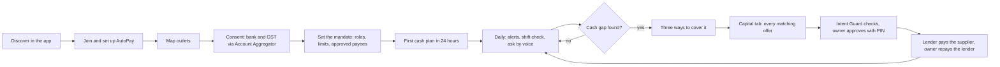
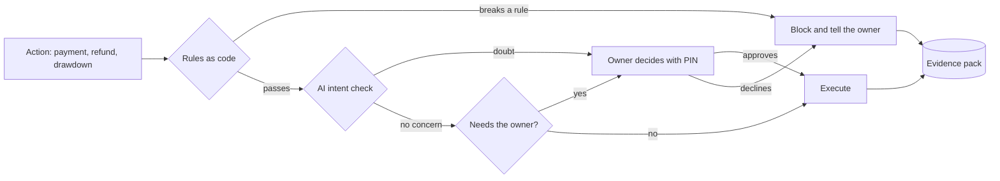

# AI Munim: Submission Pack (slide-ready content)

**Paytm Build for India AI Hackathon · Track 1: Merchant Growth AI · Kamalika Poddar**
Prepared 27 Oct 2026 · Working names: *AI Munim*, *Intent Guard*

> **What this is.** The content for the presentation we submit to Paytm, built around the seven items the hackathon rules require (title, problem, proposed solution, tech stack, USP, impact and benefits, business model), plus the user flow, screens and projections. It is a *proposal layered on the real Paytm for Business app*, not a plan for what Paytm will ship. It condenses `AI_Munim_Deck_Content.md` (the long version), `AI_Munim_Projection.xlsx` (unchanged) and `AI_Munim_Project_Plan.md` (internal detail: all assumptions, 19 wireframes, flows). Every number below is from those files.
>
> **Two honest flags that run through the pack.** (1) The Excel projection assumes no member attrition and no referrals; slide 11 says so and shows the direction. (2) What the live Paytm for Business app already does (multi-outlet view, staff roles) must be checked in the app before we submit; see the checklist at the end.

## The submission rules, and the order to present in

**Stage 1 deadline: 27 Oct 2026, 11:59 PM** (upload the PPT in the form on the hackathon page). The rules require the deck to include these seven items, for the track we selected (**Track 1: Merchant Growth AI**, "Build the AI business partner for every Paytm merchant"):

| Required by the rules | Where it is in this pack | Final-deck slide |
|---|---|---|
| Title Slide | Slide 1 | 1 |
| Problem Statement | Slide 2 (and 3, optional) | 2 (3) |
| Proposed Solution | Slides 4, 5, 6, 7, 8 | 4, 5, 6 |
| Technology / Tech Stack Used | Slide 10 | 7 |
| USP (Unique Selling Proposition) | **Slide 14 (new)** | 8 |
| Impact & Benefits | **Slide 15 (new)**, with projections from Slide 12 | 9 |
| Business Model | Slide 11 | 10 |

**Recommended final deck (11 slides, no slide cap is stated in the rules):**
1. Title and track (pack slide 1)
2. Problem (pack slide 2)
3. Four paths assessed, one chosen (pack slide 3) *(optional; drop first if you want 10)*
4. Layered on reality, and the product (pack slides 4 + 5)
5. Features and the AI inside each, plus the user flow (pack slides 6 + 7)
6. Intent Guard (pack slide 8)
7. Tech stack and how we build with AI (pack slide 10)
8. USP (pack slide 14)
9. Impact & benefits, with the 8-quarter projection (pack slides 15 + 12)
10. Business model (pack slide 11)
11. Roadmap and the ask (pack slide 13)

**Appendix (links or backup, not in the main flow):** screens (pack slide 9), competitors (Appendix 1b), judge Q&A (Appendix 1).

**Track 1 asks for solutions that help merchants "grow their business, manage operations, and serve customers better", scalable to "millions of merchants".** We cover growth (sales lift, credit at the gap) and operations (profit, cash, shift control) strongly. "Serve customers better" is our thinnest area: it shows up only indirectly (stock ready before peaks, fewer stock-outs). Say that openly if asked, and note that the product is open to every Paytm merchant, from one shop to a chain.

---

## Slide 1 · Title and track

**Headline:** *Every seth had a munim. Now every outlet gets one.*

**On the slide**
- **Track 1 · Merchant Growth AI**
- **AI Munim, with Intent Guard**: an AI accountant inside the Paytm for Business app that tells an owner what each outlet earns, when cash will run short, and what went missing at shift change, and moves money only inside the owner's limits.
- Two proof pills: `1.57 crore merchants pay for a Paytm device` · `Only 41% of India's 8.7 crore MSMEs have ever had formal credit`
- Name and credentials line (confirm wording): *15 years in fintech · loan origination for MSME and microfinance lenders · FIU-side Account Aggregator architecture*

**Speaker note (20s):** "Merchant growth isn't only more customers. For an owner with two to five outlets, growth stalls because they go blind: they can't see which outlet makes money, when cash runs short, or what happened at shift change. We built a munim for that."

---

## Slide 2 · The problem we chose

**Headline:** *The second outlet is where owners go blind.*

**Three questions an owner of 2-5 outlets can't answer today**
1. **Which outlet makes money?** Cash, other QRs, rent, salaries and supplier bills sit in one bank account and one GSTIN.
2. **When will cash run short?** Diwali stock-up, salaries on the 1st, rent on the 5th, GST on the 20th, and UPI charges above ₹2,000 once MDR starts. Owners find out at the counter, when credit is slow and uncertain.
3. **What happened at shift change?** Cash, stock and other QRs change hands twice a day with no record.

**Why it matters to Paytm:** these owners are the growing end of the device base. They need working capital for more than one counter and run several QRs at each. Paytm handles about 8% of UPI payments, so it can't win these counters through payers alone. It wins by being the owner's **view of the business**, not the cheapest QR.

**Visual:** three shopfront tiles (Dadar, Matunga, Sion), each with a question mark over a different part: the cash drawer, the calendar, the shelf.

---

## Slide 3 · Four paths assessed, one chosen

**Headline:** *Four alternatives assessed. One path to growth for Paytm merchants.*

**North Star:** the merchant's **net gain per paying outlet per month** (leakage recovered + extra margin − fees): **₹2,271** for a 2-5 outlet member with the shift-check pass (base).
**Paytm co-metric:** contribution per member outlet per month: **₹189**.

| Option | What it is | Verdict | Why |
|---|---|---|---|
| **AI Munim + Intent Guard** | Profit per outlet, 90-day cash plan, shift check, pre-approved credit, owner's mandate | **BUILD** | Answers the three questions; works on data Paytm already holds; merchant-paid |
| Restock Agent + Device Care | Orders from the shop's suppliers by voice; devices that fix themselves | **Roadmap (Restock as a Munim skill)** | Needs suppliers to join city by city; Care is mostly Paytm's own saved cost, an operations case |
| Mohalla | Neighbouring shops swap customers | **Dropped** | No consent route for other apps' users; ₹34 to win a ₹300 bill |
| Owner Mode | Staff roles, outlet view, reconciliation | **Foundation** | No AI in it; we build only what the Munim needs |

**Comparison, base case (8 quarters):** AI Munim ₹79.0 cr contribution, 59% margin, merchant-paid · Restock + Care ₹96.2 cr (includes avoided costs; its bear case loses ₹27.4 cr) · Mohalla ₹29.5 cr (bear case loses ₹2.9 cr). *Contribution is defined differently across the three; the Munim's excludes avoided costs.*

**Speaker note:** "We're not claiming Restock is a bad idea. We're saying the Munim comes first, because it earns trust and data that Restock needs."

---

## Slide 4 · Layered on reality: what the app does today, and what we add

**Headline:** *We don't rebuild the Paytm for Business app. We add a layer on top of it.*

| Paytm for Business today **[verify in the live app]** | What a multi-outlet owner still lacks | What AI Munim adds | Where it lives |
|---|---|---|---|
| Accept payments by QR, number or payment link; instant alerts; Soundbox voice alerts | A view per *outlet* across Paytm, other QRs and cash | **Profit per outlet**, with exact vs estimated labels | New *Munim* tab; outlet cards on Home |
| Transaction history, real-time tracking, refunds, business insights | A forward view; today's tools look back | **90-day cash plan** with gaps flagged weeks ahead | Munim tab; voice on phone and AI Soundbox |
| Settlement reports (MDR, GST, UTR), downloadable and emailed | Shift-level checks; a books-ready pack | **Shift check**; **CA pack** | Outlets tab; More > CA pack |
| Business loans through partners | Credit offered *at the gap*, with every matching offer shown | **Capital tab**: pre-approved lines, lowest APR first | Capital tab |
| Soundbox, QR, card machine | Control over what staff and AI can do with money | **Intent Guard**: roles, limits, approved payees, evidence log | More > Your rules |
| **Staff access across outlets: not a feature of the Paytm mobile app today** (team confirmed) | Cashier and manager logins with limits, one view across outlets | **Foundation, proposed for Paytm's web view** (we have no visibility of the web app today); the Munim reads from it | Web view (proposed); owner and cashier views on mobile |

**Foundation we propose (hygiene, no AI):** staff roles with limits, an outlet view, shift close, device status. Staff access across outlets is **not on the Paytm mobile app today**, so we propose it for Paytm's web view and treat it as a prerequisite, not the pitch. Because we cannot see the web app, every Foundation screen is a proposal, not a copy of an existing screen. Other providers already offer role-based staff access across stores (Pine Labs One, HDFC SmartHub Vyapar; see Appendix 1b), which is why we call it table stakes and keep the pitch on the AI layer.

**Principle:** reuse what Paytm already has (collections, settlements, devices, lending partners); add only the layer that connects them. Bottom tab bar in our screens uses placeholders (Home, Outlets, Munim, Capital, More); we match them to the live app.

---

## Slide 5 · The product: three questions, answered every morning

**Headline:** *A munim for every outlet, in the owner's pocket.*

| Job | What the owner gets | Where the AI is |
|---|---|---|
| **Profit per outlet** | Each outlet's monthly profit with a confidence label on every line | Reads bank narrations and voice notes into expense lines; splits shared costs; explains drivers in Hindi or English |
| **90-day cash plan** | Daily cash position, gaps flagged weeks ahead, three ways to cover each | Per-outlet sales forecast; finds recurring payments; plans options; answers by voice |
| **Shift check** | What each shift should have collected vs what it did, confirmed next morning; photo counts on 2-3 shelves | Same forecasting engine per shift; vision counts packs; patterns by shift, never by person |
| **Capital tab** | Pre-approved lines at the gap, every matching offer, lowest APR first | Sizes the drawdown to the gap; never picks the lender |

**Built from:** Paytm collections per outlet (exact), bank statements and GST returns through the Account Aggregator (business-wide), cash expenses logged by voice.
**What it doesn't pretend to know:** every number is labelled *exact* (Paytm, per outlet) or *estimated*; other-QR totals entered at handover are checked against the bank next morning.

**Demo cast:** Sharma General Stores, Mumbai: owner Rakesh Sharma, three outlets (Dadar, Matunga, Sion), seven staff. (Illustrative.)

---

## Slide 6 · The features, and the AI inside each

**Headline:** *Every feature has AI doing the work and a person holding the controls.*

| Feature | AI technique | Human control |
|---|---|---|
| Profit per outlet | LLM classification of bank narrations and voice notes; cost allocation | Owner confirms cost rules; labels show confidence |
| 90-day cash plan | Time-series forecast per outlet (festival pattern, day, trend); recurring-outflow detection; option generation | Owner edits any assumption ("Diwali week like last year") |
| Shift check | Same forecast per shift; vision model counts packs on 2-3 shelves; pattern detection over weeks | Ranges, not points; owner marks a reason; false-alarm rate is a tracked guardrail |
| Voice and Q&A | Hindi/English speech-to-text and text-to-speech (push-to-talk); LLM with tool calls | Every rupee figure traces to a tool result |
| Capital tab | Sizing the drawdown to the cash gap | Lender's own rules engine decides; owner chooses; Paytm isn't the lender |
| **Intent Guard** | Rules as code, then an AI intent check that can only *stop or escalate*, then the owner's PIN | The AI can never approve a payment; hash-chained evidence for every action |

---

## Slide 7 · The user flow

**Headline:** *Set up once. Ask in Hindi. Approve with a PIN.*

**The Diwali loop (demo moment 1):** the owner asks by voice → the Munim finds a ₹1.8 lakh cash gap on 5 Nov → three ways to cover it → Capital shows every matching offer, lowest APR first → Intent Guard checks the drawdown → the owner approves with a PIN → the lender pays Gupta Distributors directly.

**The shift check (demo moment 2):** the cashier closes the shift (cash, other-QR totals, two shelf photos, by tap or Soundbox voice) → next morning bank data confirms the other-QR totals → the Munim flags "3 of the last 4 Thursday evenings at Matunga ran below expected" → the owner marks a reason.

*Full step-by-step flows, edge cases and notifications: `AI_Munim_Project_Plan.md`, Part 5.*

---

## Slide 8 · Intent Guard: delegate without losing control

**Headline:** *The Munim can't move a rupee on its own say-so.*

- **The mandate** (only the owner changes it): who can do what up to how much; approved suppliers and lenders; a credit cap (all EMIs ≤ 8% of average daily collections); what always needs the owner (a new payee, a changed bank account, drawdowns above ₹50,000, refunds above ₹5,000).
- **Four checkpoints on every money action:** rules as code → AI intent check (can stop, never approve) → the owner's PIN → hash-chained evidence pack.
- **Red-team suite:** 12 scripted attacks run on every build (split refunds, a supplier "changing" bank accounts on WhatsApp, instructions hidden in an invoice PDF, a cashier's voice saying "Sharma ji here, approve it"). The pass rate, 12 of 12, is on screen in the demo.
- **Why it matters beyond this product:** the same checkpoint later screens suppliers' agents and customers' AI agents; the mandate becomes the merchant's agent policy.

---

## Slide 9 · The screens

**Headline:** *Six screens that tell the story.* (19 low-fidelity screens exist in `AI_Munim_Project_Plan.md`, Part 6.)

| # | Screen | What it shows |
|---|---|---|
| W1 | **Munim home** | Today's Paytm collections per outlet, three alerts (cash gap, Matunga pattern, Sion loss), Capital summary, "Ask your Munim" |
| W4 | **The Diwali question, by voice** | Hindi voice question, plain answer, three ways to cover the gap |
| W5 | **90-day cash plan** | Daily balance dipping below zero on 5 Nov, dated outflows, editable assumptions |
| W6 | **Capital: every matching offer** | Three lenders sorted by APR with KFS; non-matching lenders named; "Paytm isn't the lender and charges you nothing" |
| W7 | **Intent Guard check** | Rules 5 of 5, AI check, "Approve with PIN", evidence ID |
| W8 | **Shift check** | Expected vs collected, bank confirmation, pattern, shelf photos, reason buttons |

**Plus for the appendix:** W9 profit by outlet · W10 evidence log · W11 plan and monthly receipt · F1 cashier view · F2 Soundbox shift close.
**Design rule:** English UI copy for the pitch; voice lines in Hindi; no Paytm logo drawn, official assets dropped in later.

*Gaps to close before building screens:* the voice expense-logging screen, a cost-rules entry screen and the "change assumption" screen are not wireframed yet.

---

## Slide 10 · Tech stack, and how we build the MVP with AI

**Headline:** *What we build in 8 hours, how we build it, and what it plugs into.*

### The stack

| Layer | What we use |
|---|---|
| **Data** | Synthetic data for Sharma General Stores: 3 outlets, 6 months of Paytm transactions tagged by QR, outlet and shift; bank statements and GST returns in the Account Aggregator's ReBIT formats (from an AA sandbox); voice-logged expenses; shelf photos |
| **Munim** | An LLM with tool calls for Hindi/English questions and bank-narration parsing; one forecasting engine (last year's festival pattern, day and time, recent trend) for the cash plan per outlet and expected collections per shift |
| **Shift check** | Expected vs collected from the same engine; a vision model counts packs on two shelves; pattern detection over weeks |
| **Intent Guard** | Rules as code; an LLM intent check that can only escalate; SHA-256 hash-chained log; the red-team suite as automated tests |
| **Capital tab** | Three simulated lenders with their own rules engines and KFS; offers ranked by APR; simulated UPI AutoPay |
| **Voice and payments** | Indic speech-to-text and text-to-speech (push-to-talk only); Paytm's payment gateway sandbox or a simulator |
| **Front end** | React mobile web for owner and cashier roles; the AI Soundbox simulated as a screen plus laptop speaker |
| **In production** | Paytm Payments Services as the FIU on the Account Aggregator, Paytm's own models, real lending partners |

### How we build it: with AI, under human gates (AI-DLC)

The MVP is built the way the product asks owners to work: AI does the drafting, people hold the gates.

| Step | What AI does | What the team decides |
|---|---|---|
| **Inception (first 30 min)** | Turns our intents (profit, cash plan, shift check, Capital, Intent Guard) into units of work, acceptance checks and a risk list | Approves the units and the checks |
| **Construction (7 hours, in short "bolts" of 45-60 min)** | Writes the domain model, code and tests for each unit; generates the synthetic data | Reviews every change on money paths and Intent Guard; runs the evals |
| **Evals as "done"** | Runs after each bolt: forecast within tolerance, Q&A figures traceable to tool results, red-team 12 of 12 | A unit doesn't count as done until its evals pass |
| **Operations (last 30 min)** | Runs the red-team suite live, rehearses the demo | Calls go / no-go on the demo |

| Hours | Build |
|---|---|
| 0-1 | Synthetic data for 3 outlets; AA-format bank and GST files |
| 1-3 | Forecasting engine and cash plan: per-outlet forecast, recurring outflows, gap finder, three options; Hindi voice |
| 3-4 | Capital tab: 3 simulated lenders, offers by APR, KFS |
| 4-5.5 | Intent Guard: mandate, rules, AI check, hash-chained log, red-team suite |
| 5.5-6.5 | Shift check: expected vs collected, handover flow, two shelf photos |
| 6.5-7.5 | Screens; profit per outlet and the plan screen as precomputed views |
| 7.5-8 | Run the red-team suite live; rehearse |

*After the hackathon (if selected):* the same method scales to a production pilot; detail in `AI_Munim_Project_Plan.md`, Part 3.

---

## Slide 11 · Business model

**Headline:** *Join once. Pay for what you use. Credit is free to the merchant.*

### Revenue levers (base prices per month, excluding GST)

| Lever | Who pays | Price |
|---|---|---|
| **Membership**, per business, first 5 outlets included | Merchant | ₹199 |
| **Extra outlets** (6-10 / 11-20 / 21+) | Merchant | ₹49 / ₹79 / ₹99 each |
| **Shift-check pass**, per outlet | Merchant | ₹99 |
| **CA pack**, per business | Merchant | ₹99 |
| **Credit:** share of each drawdown | Lender | 2% |
| **Capital tab** | Free to every merchant, member or not | — |

Billed on its own line (not with the Soundbox), by UPI AutoPay, with a reminder before every charge, a 12-month price lock, one-tap cancel and a monthly receipt of what the owner paid versus what the Munim found.

### Where the money comes from (base, 8 quarters)

Membership ₹54.1 cr · add-ons ₹1.6 cr · passes ₹16.1 cr · CA packs ₹5.4 cr · credit (lender-paid) ₹54.4 cr · payments and device subscriptions ₹2.0 cr · **Total ₹133.7 cr**.

### Cost levers (base, 8 quarters)

AI ₹11.6 cr · photo checks ₹5.9 cr · Account Aggregator data ₹4.1 cr · support ₹5.6 cr · onboarding ₹8.5 cr · collection and servicing ₹8.2 cr · credit-loss sharing ₹10.9 cr · **Total ₹54.7 cr** → **contribution ₹79.0 cr, margin 59%** (before fixed engineering and field salaries).

### Unit economics (base, Q3 FY29)

₹189 contribution per member outlet per month · ₹323 per member business · onboarding paid back in about 1.2 months · merchant nets 13.7× the fees paid.

### What this model leaves out (say it before a judge does)

| Not in the numbers | Direction | Why it matters |
|---|---|---|
| **Member attrition.** The projection assumes no one cancels after joining | Lowers revenue and contribution | Illustration, outside the Excel: if gross sign-ups are as modelled and 2% / 3% / 5% of members cancel each month, Q3 FY29 paying members would be about 82% / 75% / 63% of the modelled 2.11 lakh, and member-quarters 11% / 16% / 25% lower. Contribution would fall by a similar order, roughly ₹66 cr at 3% (a rough estimate, since onboarding cost sits on gross sign-ups) |
| **Referrals.** No word-of-mouth or owner-to-owner referral | Raises sign-ups or lowers onboarding cost | Onboarding is ₹8.5 cr of cost; a referral channel that cut a third of it would add roughly ₹2.8 cr. Referral credit (e.g., a free month) would be a cost lever to set |
| Fixed costs (engineering, field, platform) | Lowers net return | Contribution is not EBITDA |
| Member perk on Paytm QRs, Restock as a skill, agent payments | Raises | Deliberately not counted |
| Lender take rate (2%) and loss sharing | Uncertain | Not published by Paytm; first thing to confirm |

**To tweak before final numbers:** add monthly attrition and a referral rate as explicit inputs; make onboarding cost fall as referrals rise; set a referral reward; revisit pass uptake and the 2% credit share. *(The Excel is unchanged for now, by decision.)*

**Ruled out:** bundling into the Soundbox rental, charging merchants for credit, selling merchant data, a share of leakage found, a free tier.

---

## Slide 12 · Impact and projections

**Headline (base):** **₹79.0 crore of contribution and ₹2,382 crore of new GMV in 8 quarters; ₹19.8 crore a quarter by Q3 FY29, at a 59% margin.**

| Base case | Q4 FY27 | Q1 FY28 | Q2 FY28 | Q3 FY28 | Q4 FY28 | Q1 FY29 | Q2 FY29 | Q3 FY29 | 8-qtr |
|---|---:|---:|---:|---:|---:|---:|---:|---:|---:|
| Paying members (thousand) | 9.9 | 30.7 | 63.6 | 98.7 | 136.0 | 163.8 | 193.0 | 211.3 | |
| Incremental GMV (₹ cr) | 20 | 65 | 141 | 231 | 334 | 429 | 535 | 627 | 2,382 |
| Revenue (₹ cr) | 1.4 | 4.5 | 9.3 | 14.5 | 20.0 | 24.1 | 28.5 | 31.3 | 133.7 |
| Contribution (₹ cr) | 0.5 | 2.1 | 4.8 | 8.1 | 11.6 | 14.7 | 17.5 | 19.8 | 79.0 |
| Margin | 38% | 47% | 51% | 56% | 58% | 61% | 61% | 63% | 59% |

| | Bear | **Base** | Bull |
|---|---:|---:|---:|
| Contribution, 8 qtrs | ₹2.1 cr | **₹79.0 cr** | ₹707 cr |
| Incremental GMV, 8 qtrs | ₹186 cr | **₹2,382 cr** | ₹14,354 cr |
| Paying members, Q3 FY29 | 81,200 | **2,11,300** | 4,61,300 |
| North Star: merchant net gain per outlet per month | ₹831 | **₹2,271** | ₹6,544 |
| Contribution per member outlet per month | ₹45 | **₹189** | ₹633 |

**Say plainly:**
- This is a **contribution play, not a GMV play**: ₹2,382 crore is 0.03% of Paytm's baseline GMV. Fees merchants pay (58% of revenue) and the Capital tab (41%) drive it.
- Half of the contribution comes from single shops, at 1 in 100 paying. That is our least-known assumption, and the pilot has an explicit gate for it.
- The numbers assume no attrition and no referrals (slide 11); real figures need both. The bear case is contribution-positive only before fixed costs.
- Method: baseline Paytm GMV uses a linear forecast on 8 reported quarters; the exponential line is 24% higher, so we use the conservative one.

**Merchant side (the part that justifies the fee):** per outlet per month, ₹1,750 of leakage recovered + ₹700 of extra margin − ₹179 of fees = **₹2,271 net**. Single shop: ₹201 net from the cash plan alone. These are estimates a pilot would test.

---

## Slide 13 · Roadmap and the ask

**Headline:** *Prove it in Mumbai. Then add skills under the same mandate.*

| When | What | Gate |
|---|---|---|
| **Pilot** (Jan-Mar 2027, Mumbai) | AI Munim + Intent Guard; Hindi, English, Marathi | Five gates after two quarters: ≥ 7% of 2-5 outlet businesses reached pay · net gain ≥ ₹1,000 per outlet per month vs matched outlets · ≤ 1 in 5 shift flags dismissed as false alarms · drawdown overdues no worse than partners' own books · ≥ 0.5% of single shops pay |
| **Next** (FY28) | Restock as a Munim skill (orders to the shop's own suppliers inside the same mandate); member perk on Paytm QRs; CA dashboard | Members use the cash plan weekly; suppliers accept digital orders |
| **Later** (FY29) | Agentic commerce: Intent Guard screens suppliers' and customers' AI agents | Red-team suite extended to agent-to-agent cases |

**The ask from Paytm:** (1) the count of PANs by number of outlet IDs, which replaces our biggest segment estimate; (2) device churn for multi-outlet merchants; (3) lending partners' take rates and loss-sharing terms; (4) access to an Account Aggregator sandbox for Paytm Payments Services as FIU.

---

## Slide 14 · USP (Unique Selling Proposition)

**Headline:** *Paytm already holds what a munim needs. We connect it, and let AI act inside the owner's limits.*

**Three things only Paytm has in one place**
1. **Every outlet's Paytm collections,** exact, per QR and Soundbox.
2. **A regulated route to the rest of the business:** bank statements and GST returns through the Account Aggregator (Paytm Payments Services as the FIU, a proposal to confirm).
3. **Lending partners who can pre-approve credit** using their own rules engines.

**What makes it different** (from public pages for PhonePe for Business, BharatPe, Google Pay for Business, Pine Labs and HDFC SmartHub Vyapar, which I did not verify inside their apps)

| USP | Why it matters |
|---|---|
| **Profit per outlet across Paytm, other QRs, cash and costs,** with exact vs estimated labels | Owners with several outlets can't see which one carries the others; reports look at payments only |
| **A 90-day cash plan** with the festival calendar, gaps flagged weeks ahead | Reports look back; owners need to look forward |
| **Shift check:** expected vs collected, confirmed by next-day bank data, patterns by shift, never by person | Cash, stock and other QRs change hands twice a day with no record |
| **Credit at the gap:** pre-approved lines, every matching offer shown lowest APR first, free to the merchant, lender pays the supplier | Credit arrives before the shortfall, not after; consistent with RBI's digital lending rules |
| **Intent Guard:** the AI acts only inside the owner's mandate, can never approve a payment, and every action leaves a tamper-evident record; 12 of 12 red-team attacks blocked or escalated | The trust layer that makes AI that moves money safe to sell, and the base for agentic commerce |
| **Voice-first, in Hindi, English and Marathi,** on the phone and the AI Soundbox | Owners talk, they don't fill forms |

**One line:** *Others show owners what happened. The Munim tells them what will happen, what to do, and does it only within their limits.*

---

## Slide 15 · Impact and benefits

**Headline:** *The merchant gains more than the fee. Paytm earns from a product merchants choose to pay for.*

| For | Benefit (base case, estimates a pilot would test) |
|---|---|
| **Owner of 2-5 outlets** | **₹2,271 net gain per outlet per month** (₹1,750 leakage recovered + ₹700 extra margin from stock ready before peaks − ₹179 fees), 13.7× the fees. Credit before the gap, at the lowest APR on offer |
| **Single shop** | ₹201 a month net from the cash plan alone (thin, so we assume only 1 in 100 pay) |
| **Paytm** | ₹79.0 crore of contribution over 8 quarters at a 59% margin; ₹19.8 crore a quarter by Q3 FY29 (9.7% of Q1 FY27 EBITDA); ₹2,382 crore of new GMV; ₹2,720 crore of credit through partners, nothing on Paytm's books; devices kept longer |
| **Lenders** | Lines underwritten on their own consented data; repayment sized to collections; an evidence pack showing where the money went |
| **Staff and the CA** | Clear roles and limits; checks that look at shifts, not people; a monthly pack for the CA |
| **Scale** | Open to every Paytm merchant (1.57 crore pay for a device). Base case: 2.11 lakh paying businesses, 3.62 lakh outlets by Q3 FY29 |

**Say plainly:** this is a contribution play, not a GMV play (₹2,382 crore is 0.03% of Paytm's baseline GMV). The projections assume no member attrition and no referrals; see slide 11. Use the table on slide 12 for the 8-quarter numbers.

---

## Appendix 1 · Likely judge questions

| Question | Answer |
|---|---|
| Why not just grow GMV? | Under ₹2,000, UPI earns Paytm no MDR; GMV barely moves the P&L. Contribution comes from things merchants pay for and credit lenders pay for. |
| Why will an owner pay ₹199 a month? | At base, it nets them ₹2,271 per outlet per month against ₹179 in fees. That is our hypothesis, and the pilot gate is a measured ₹1,000. |
| Won't single shops say no? | Most will. We assume 1 in 100 pay, reach them in the app at no field cost, and stop paid acquisition if fewer than 0.5% pay. |
| How do you see per-outlet profit with one bank account? | Paytm collections are exact per outlet. Everything else is labelled estimated. Other-QR totals entered at handover are checked against bank data the next morning. |
| What if the owner refuses bank access? | The Munim still works on Paytm data, labelled as such. Consent is purpose-specific and revocable in one tap. |
| Isn't this a lending product? | Credit is one tab, free to every merchant, paid by lenders, and capped below half of revenue by design. The lender pays the supplier; Paytm never touches the money. |
| What stops the AI doing something wrong with money? | It can't approve anything. Rules as code come first, then an AI check that can only stop or escalate, then the owner's PIN. Every action is logged in a hash-chained record. |
| Does the shift check feel like surveillance? | Patterns by shift, never by person; two shelves only, faces blurred; only the owner sees results; staff are told at onboarding. |
| Why not Restock first (higher base contribution)? | Restock needs suppliers to join city by city, and Care's value is mostly Paytm's own savings. The Munim earns the trust and data Restock needs. |
| Are the projections realistic? | They are an argument for why this feature, not a forecast. They assume no attrition or referrals (we say so), and use team estimates, flagged on every slide. |
| What exists today vs what you add? | Slide 4: Paytm already has payments, settlements, reports, loans and devices; we add outlet profit, the cash plan, shift checks and the mandate. |
| What's built in 8 hours vs production? | The loop end to end on synthetic data with simulated lenders. Production needs Paytm Payments Services as FIU and real lenders. |
| How is your team building it? | With AI agents under human gates and evals as the definition of done (slide 10). |
| Who else does this? | Appendix 1b. PhonePe for Business, BharatPe, Google Pay for Business, Pine Labs and HDFC SmartHub Vyapar all offer payments, settlements, reports or loans, and two (Pine Labs One, SmartHub Vyapar) offer staff roles across stores. In the public material I found, none offers a per-outlet profit view across cash and other QRs, a 90-day cash plan, shift checks or a mandate for AI actions. That is a finding from public pages, not a proof. |

## Appendix 1b · Named competitors (from public pages, checked 27 Oct 2026)

Findings come from public search results, several dated or from third parties. **Confirm each in its live app before claiming "nobody offers X".**

| Provider | What public sources show | Staff roles / multi-store | What we found no evidence of |
|---|---|---|---|
| **PhonePe for Business** | Payment gateway, store QR, Soundbox (SIM-enabled, 10+ languages), POS, payment links, dashboard for sales analytics and settlement tracking; a lending offering | Multi-outlet Soundbox deployment mentioned by an integrator; no staff-role details found | Per-outlet profit, cash planning, shift checks, a mandate for AI actions |
| **BharatPe** | UPI-data-based working-capital loans (daily instalments), speaker alerts, instant settlement, insights, a dashboard for tracking customers who owe the merchant | Not found | Staff roles, multi-store view, accounting, cash planning |
| **Google Pay for Business** | SoundPod (listing dates from 2024), business loans and credit lines through partner lenders (up to ₹8 lakh per a third-party listing) | Not found | Staff roles, outlet view, cash planning, 2026 confirmation of any of this |
| **Pine Labs** | Pine Labs One management app and web dashboard (all transactions, payout reports for reconciliation, **role-based employee access across multiple stores**, device ticketing); myPlutus (insights, loan application); Smart POS with billing apps | **Yes (Pine Labs One)** | A forward-looking cash plan, per-outlet profit incl. cash and other QRs, shift checks |
| **HDFC SmartHub Vyapar** | Payments across all stores in one view, **staff logins with roles (cashier, manager)**, downloadable transaction and settlement reports, business loans and overdraft; for HDFC Bank customers | **Yes** | Cash planning, profit per outlet, shift checks, AI mandate; account needed with HDFC |

**What this means for the pitch**
- Staff roles and a multi-store view are **table stakes** at two competitors; Paytm lacks them on mobile. They are the foundation (hygiene), not the headline.
- The differentiators we can defend are: **forward-looking cash plan, profit per outlet across cash and other QRs, shift checks with bank confirmation, every matching credit offer shown, and the owner's mandate for AI actions.**
- Paytm's own advantages: collections per outlet already inside Paytm, devices at the counter, and lending partners.
- Biggest competitive risk: Pine Labs (POS plus multi-store management) and banks with owners' accounts (HDFC) moving up from reporting into planning.

## Appendix 2 · Checklist before submitting

| # | Check | Why |
|---|---|---|
| 1 | Open the live Paytm for Business app and confirm: device status, shift close, current business-loan limits. (Staff access across outlets is confirmed as **not** on the mobile app) | Slide 4 is only credible if it matches the real app. We have no visibility of Paytm's web view, where we propose staff access |
| 2 | **Upload the PPT before 11:59 PM on 27 Oct 2026** with the seven required items (title, problem, proposed solution, tech stack, USP, impact and benefits, business model). Judging criteria will only be shared with shortlisted teams | Deadline in the rules you pasted |
| 3 | Confirm the credential line wording | Slide 1 |
| 4 | Confirm partner and tool names before naming them (voice, workflow, memory tools) | Event partner list needs portal confirmation |
| 5 | Re-read slide 11 and 12 aloud: attrition, referrals and fixed costs are called out | A judge who finds them first will discount the rest |
| 6 | Wireframe gaps: voice expense logging, cost-rules entry, assumption editing | Slide 9 note |
| 7 | Verify the Appendix 1b competitor findings in each live app | Several sources were dated or third-party |
| 8 | Check every figure against the Summary sheet of `AI_Munim_Projection.xlsx` | The Excel is the source of truth for numbers |

## Appendix 3 · Source map

| Topic | Where |
|---|---|
| Full slide-by-slide deck content, red-team suite, roadmap, risks | `AI_Munim_Deck_Content.md` |
| Projections, scenarios, sensitivities | `AI_Munim_Projection.xlsx` → Summary; deck slides 11-12, Appendices A-B |
| 19 wireframes, user flows (Parts 5-6), full assumptions register (Part 4), AI-DLC delivery plan (Part 3) | `AI_Munim_Project_Plan.md` |
| The two options we didn't choose | `Restock_Care_Deck_Content.md`, `Mohalla_Deck_Content.md` and their workbooks |
