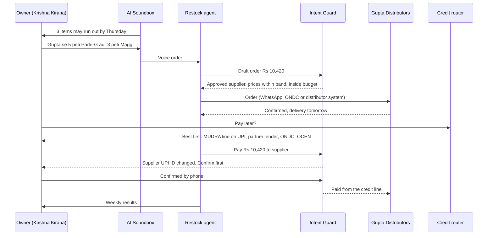

# Restock Agent, with Intent Guard + Soundbox Care: deck content

**Paytm Build for India AI Hackathon, Mumbai Edition · Track 1: Merchant Growth AI · Kamalika Poddar**
Stage 1 pitch content, 27 Oct 2026. Every projection number comes from `Restock_Care_Projection.xlsx` (Summary sheet). Change an input on its Assumptions sheet and the numbers move with it. This version replaces the Mohalla draft; Mohalla now appears only as an option we assessed and dropped (slide 2, Appendix D).

**How each slide is laid out here:** headline, what goes on the slide, visual direction, notes (the detail behind the slide, for judges reading the PDF), footnotes. *Restock Agent*, *Intent Guard* and *Soundbox Care* are working names.

### Where the hackathon's required sections live

| Required in the template | Slide |
|---|---|
| Title | 1 |
| Problem statement | 2 (top strip); optional standalone slide 1b |
| Proposed solution | 3 and 4 |
| Technology / tech stack | 5 |
| USP | 2 (card verdicts) and 3 |
| Impact and benefits | 3 and 7 |
| Business model | 6 |

---

## Slide 1 · Title

**On the slide**
- Name: **Kamalika Poddar**
- **Track 1 · Merchant Growth AI** · Paytm Build for India AI Hackathon, Mumbai Edition
- Product: **Restock Agent, with Intent Guard + Soundbox Care**
- Tagline (pick one, 5 words each):
  - **Shelves stocked. Soundbox always on.**
  - **The counter that runs itself.**
  - **Stock smarter. Never miss payments.**
- One sentence: *An agent on the Paytm AI Soundbox reorders a kirana's stock from its own suppliers, pays them only inside the owner's limits, finds the best credit across four rails, and keeps the Soundbox itself running.*
- Two highlight pills:
  - `1.57 crore merchants pay for a Paytm device`¹
  - `Only 41% of India's 8.7 crore MSMEs have ever had formal credit`²

**Visual direction:** white background, navy headline, Paytm Blue pills. A simple line illustration of a shop counter: the Soundbox in front, shelves behind, a delivery crate arriving.

**Footnotes**
1. Subscription merchants including devices, Q1 FY27 (quarter ended 30 Jun 2026). Paytm Q1 FY27 results.
2. Registered MSMEs (Dec 2025) vs those ever credited (Mar 2026). TransUnion CIBIL–SIDBI MSME Pulse, Jul 2026.

---

## Slide 1b · Problem (optional, if you follow your 2-swipes order)

**Headline:** Kiranas don't lose sales at the counter. They lose them on the shelf.

**On the slide**
- **Empty shelves, tight cash.** A kirana buys from several suppliers through salesmen, calls and WhatsApp. FMCG companies' own apps only cover their own brands (HUL's Shikhar reached over a million stores and about a quarter of HUL's general trade).¹ Only 41% of registered MSMEs have ever had formal credit, and bank MSME credit grew 23% while the number of borrowers stayed flat.²
- **A dead Soundbox costs more than a speaker.** UPI still works without it, but the merchant loses confirmations (and falls back on screenshots, which can be spoofed), card payments on AI Soundboxes stop, and an engineer has to visit.³
- **Paytm's GMV is growing, but kirana payments under ₹2,000 earn no MDR.** A 1% GMV lift is worth ~₹6 crore a quarter at Paytm's blended rate, far less on kirana UPI. The money is in what the counter buys: supplier payments above ₹2,000 (MDR after Diwali), and credit.⁴

**Footnotes**
1. Consumer Goods Technology on HUL's Shikhar (2023).
2. CIBIL–SIDBI MSME Pulse, Jul 2026; RBI Annual Report 2025-26 (summary).
3. Paytm on spoof payment apps (2022); Paytm AI Soundbox launch (Oct 2025).
4. Baseline sheet; UPI MDR of 0.40% above ₹2,000, deferred to after Diwali (Inc42, 13 Oct 2026).

---

## Slide 2 · 4 alternatives assessed. 1 path to winning growth for Paytm merchants.

**Problem strip (one line under the headline)**
Kirana payments under ₹2,000 earn Paytm no MDR, so growing GMV alone barely moves the P&L. The money is in what the counter buys (supplier payments, credit) and in keeping Paytm's device on the counter.

**North Star box (top right)**

| | |
|---|---|
| **North Star** | Paytm-processed GMV per active device merchant, now including the shop's supplier payments |
| **Co-headline** | Contribution per device merchant |
| **Guardrails** | Device uptime and retention; credit quality of routed loans (partners' overdue rates) |

### The four cards (pricing-card layout, cards 3 + 4 highlighted and bracketed as one bundle)

**1 · Loan-Ready** (credit readiness and lending) · Verdict: **Folded into Restock**
- **What it is:** coach merchants towards a loan; underwrite on Account Aggregator cash flows; route to OCEN, ONDC Financial Services or Paytm's lending partners.
- **Why it's tempting:** Paytm's financial services revenue grew 45% to ₹814 crore, partners book the loans, and over half of merchant-loan value goes to repeat borrowers.¹
- **Why not on its own:** everyone pitches lending, and lender appetite, not merchant readiness, is the constraint. Small business loans of ₹2-10 lakh are the slowest-growing segment, with 5.6% of balances 90+ days overdue.² Approval rates swing from ~47% for data-rich applications to under 1% for open-network leads.³ So we put credit where it's safest: inside one purchase, paid straight to a verified supplier. That's the Restock credit router.
- **We evaluated:** AA cash-flow underwriting · OCEN · ONDC Financial Services · MUDRA credit line on UPI.
- **RICE (year 1):** 0.25⁴

**2 · Nearby** (consented offers in the Paytm app) · Verdict: **Phase 2, if NPCI's cap is enforced**
- **What it is:** hyperlocal offers shown only to Paytm-app users who opted in. An uplift model charges the merchant only for customers who wouldn't have come anyway.
- **Why it's tempting:** merchant-funded offers can replace cashback Paytm funds itself (₹90 crore in Q1 FY27).¹ If switched on, it adds ₹35.5 crore of contribution over 8 quarters (base).⁵
- **Why it waits:** it reaches only Paytm-app payers (Paytm handles ~8% of UPI payments), customers partly move between Paytm shops, and its main tailwind, NPCI's 30% cap, is due 31 Dec after two extensions.⁶
- **Replaces Mohalla (dropped):** promoting neighbours on the Soundbox needs consent Paytm can't get from other apps' users, and at kirana margins the shop pays ₹34 to win a ₹300 bill. See Appendix D.
- **RICE (year 1):** 0.2⁴

**3 · Restock Agent, with Intent Guard** · Verdict: **BUILD (hero)**
- **What it is:** an agent on the AI Soundbox and the Business app that predicts stock-outs from the shop's supplier bills and Paytm sales, takes the order by voice, sends it to the shop's own suppliers, and pays only inside the owner's limits. Pay-later goes to whichever rail gives the merchant the best approval chance and cost: Paytm's partner lenders, a MUDRA credit line on UPI, OCEN or ONDC.
- **Why we're building it:** it grows the shop's sales (fewer stock-outs, more stock on credit). It also moves supplier payments onto Paytm: 62% of the bundle's new GMV in the base case. And it makes credit safer to give, because the guard's log shows the lender the money paid a verified supplier for a specific order.
- **Moves the North Star via:** merchant sales ✓ · supplier payments ✓ · credit ✓
- **RICE:** 0.27 in year 1, rising as suppliers come on board⁴

**4 · Soundbox Care** (self-healing devices) · Verdict: **BUILD (second)**
- **What it is:** the Soundbox spots its own faults (missed announcements against Paytm's payment records, battery, signal), fixes what it can remotely, announces payments on the owner's phone while it's down, and gets a replacement out before it fails.
- **Why we're building it:** highest year-1 RICE (2.25), and in the base case it earns 73% of the bundle's contribution over 8 quarters. It keeps Paytm's device on the counter.
- **Moves the North Star via:** GMV kept during downtime ✓ · device retention ✓ · cost per device ✓
- **RICE (year 1):** 2.25⁴

**Also assessed (one-line strip under the cards):** Mohalla, Soundbox cross-promotion (dropped: consent and merchant economics) · UPI tax and compliance copilot (Phase 2 add-on; RICE 1.0) · agent-ready storefronts for customers' AI agents (roadmap: the consumer side of Intent Guard).

**Visual direction (maps onto your reference image)**
- Header: headline in navy; small caps subline "CHOOSE THE PATH" with a Paytm Blue underline.
- Card top label = option type ("Credit", "Demand", "Supply and credit", "Uptime"); grey band = option name; the green price line = the RICE score; small grey lines = *What it is*; bold line = the one-line verdict reason; "Final deliverables" = *Moves the North Star via* with ✓; the blue "details .pdf" link = *We evaluated* or *Replaces*.
- Cards 3 and 4: raised, Paytm Blue header band, star corner ribbon, green check. A bracket across both: **"Building: Restock Agent + Soundbox Care"**. Cards 1 and 2: grey header. The blue down-arrow under the bundle leads into slide 3.

**Footnotes**
1. Paytm Q1 FY27 results; merchant-loan repeat share as reported by Paytm (Aug 2022 release).
2. CIBIL–SIDBI MSME Pulse, Jul 2026 (balances at Mar 2026, entities with ₹2-10 lakh exposure).
3. Public-sector banks' digital MSME model, Apr-Oct FY26 (Business Standard); team field estimate for open-network applications.
4. RICE = Reach × Impact × Confidence ÷ Effort. Reach = lakh merchants using it in year 1; Impact 2 / 1 / 0.5; Effort = person-months to a production pilot. Restock 3 × 2 × 40% ÷ 9; Care 15 × 1 × 60% ÷ 4; Nearby 3 × 1 × 40% ÷ 6; Loan-Ready 10 × 0.5 × 50% ÷ 10; Tax copilot 10 × 1 × 50% ÷ 5. Team estimates.
5. `Restock_Care_Projection.xlsx`, Summary sheet (Nearby switch off in the base case).
6. Outlook Business, Jun 2026 (May 2026 data: PhonePe and Google Pay 79%, top three 87%).

---

## Slide 3 · The bundle: the shop's agent keeps the shelves stocked and the Soundbox running

**Headline options**
- *Stock, credit and uptime, handled at the counter.*
- *Your shelves restock themselves. Your Soundbox fixes itself.*

**Sub-line:** The owner sets limits once. The agent only moves money inside them.

**Cast for every screen and the demo:** Krishna Kirana, Dadar West, Mumbai, and its owner. Suppliers: Gupta Distributors (FMCG, weekly), Shree Dairy (milk and bread, daily), Patel Traders (staples, fortnightly). An AI Soundbox on the counter.

### Flow A · Restock (8 steps, with the owner's effort)

| # | Step | What happens | Owner effort |
|---|---|---|---|
| 01 | **Set up** | Photograph the last few supplier bills, or link a supplier. The agent builds the item list, prices and each supplier's cycle. AA consent for bank statements is optional and only unlocks credit. | About 10 minutes, once |
| 02 | **Set limits** | Weekly budget, approved suppliers, price band (within 3% of the last bill), pay-later cap, and mode: *Ask me* (free) or *Autopilot* (paid plan). | Once, by tap or voice |
| 03 | **Predict** | From Paytm's daily sales and the purchase history, the agent predicts which items run out and when. | None |
| 04 | **Order by voice** | The owner holds the Soundbox button and says the order. The agent drafts it at last-bill prices. | One sentence or one tap |
| 05 | **Supplier confirms** | The order goes to the distributor by WhatsApp, ONDC or the distributor's system; price and delivery come back. | None |
| 06 | **Pay, or pay later** | On delivery the agent pays the supplier's verified UPI ID. If cash is tight, the credit router compares the four rails and shows the best option first; credit pays the supplier directly. | One tap |
| 07 | **Guard** | Before money moves: approved supplier, unchanged UPI ID, amount matches the order, no duplicate, inside budget and credit cap. Anything else goes to the owner. | Only when asked |
| 08 | **Learn** | Weekly card: stock-outs avoided, spend vs budget, credit cost, payments the guard stopped. The agent suggests changes. | One tap |

### Flow B · Soundbox Care (4 steps, owner effort: none)

| # | Step | What happens |
|---|---|---|
| 01 | **Detect** | Paytm sees every payment. If the Soundbox didn't announce one, or battery or signal drops, Care flags it within minutes. |
| 02 | **Heal** | Switch between Wi-Fi and 4G, reboot, roll back firmware, or talk the owner through a fix in Hindi or Marathi. |
| 03 | **Continue** | While the device is down, payments are announced on the owner's phone, so the counter keeps taking Paytm QR and "paid" screens can be checked against Paytm's records. |
| 04 | **Pre-empt** | Predict which devices will fail and ship a replacement first; when an engineer is needed, they arrive with the diagnosis. |



### Why item-level data isn't a blocker
Paytm sees rupees, not items, and kiranas don't run inventory software. Restocking doesn't need to know what each customer bought. It needs to know what the shop buys and how fast its money turns:
- **Supplier bills** (photographed once, or pulled from the distributor's system) give items, quantities, prices and cycles.
- **AA bank statements** (with consent) show which suppliers get paid and how often, and underwrite credit.
- **Paytm's daily sales** give the selling pace.
- **Every order the agent places** is item-level data, so the picture sharpens with use.
- Optional: a weekly shelf photo, and push-to-talk billing for shops that want GST bills. Considered and rejected: an always-listening Soundbox, because recording customers can't be consented to.

### How the bundle protects GMV growth
- **The counter keeps taking Paytm payments when the device fails.** Care keeps ₹650 crore of GMV during downtime and ₹10,840 crore through lower device churn over 8 quarters (base).¹
- **Supplier payments can't go to the wrong account.** Intent Guard stops payee swaps, duplicates and price errors: ₹97.2 crore of merchant money protected over 8 quarters (base).¹
- **Credit stays affordable.** Merchant-first routing picks the best hit rate and cost, so merchants keep borrowing through Paytm.

### How it grows Paytm's share of the counter (point of sale)
- **Supplier payments move onto Paytm**, ₹20,420 crore of payments new to Paytm over 8 quarters (base).¹ The distributor collects through Paytm's payment links or gateway, or QR on delivery, so Paytm sits on both sides of the payment.
- **The AI Soundbox becomes the shop's operating terminal** for ordering, credit and alerts. That's a reason to keep Paytm's device even if a shared NPCI soundbox arrives.
- **Above ₹2,000, supplier payments carry MDR once it's live:** ₹12.3 crore over 8 quarters (base).¹

### USP
Built on what Paytm already has at the counter: the shop's sales ledger, the AI Soundbox (screen, voice and card acceptance), and a lending business earning ₹814 crore a quarter. The new piece is an agent that pays a merchant's suppliers behind a guard a lender can trust, on a device that fixes itself.

### Impact and benefits

| For | Benefit |
|---|---|
| Merchant | Fewer stock-outs and more stock on credit (sales +2% assumed, tested against holdout shops), credit at the best available rate, payments that can't be redirected. Net gain ₹204 a month on the paid plan using pay-later, plus ₹175 a month of supplier money protected (base).¹ |
| Paytm | ₹96.2 crore of contribution over 8 quarters and ₹27.0 crore a quarter by Q3 FY29, equal to 13% of Q1 FY27 EBITDA (base). ₹32,799 crore of new GMV. 3.3× the contribution Mohalla would have made.¹ |
| Lenders | Credit tied to one order, paid to a verified supplier and underwritten on AA data, with the guard's log as proof of use. |
| Suppliers | Digital orders, faster payment, and fewer salesman visits. |

**Footnotes**
1. `Restock_Care_Projection.xlsx`, Summary sheet, base case.

---

## Slide 4 · The feature, screen by screen (textual wireframes)

Ten low-fidelity screens on the existing Paytm for Business app and the AI Soundbox. Paste each **Stitch prompt** into Google Stitch with the shared style prompt below.

**Shared style prompt for Stitch**
> Android-first mobile app screen, 360 × 800, light theme, styled like the Paytm for Business app. Primary colour Paytm Blue #00BAF2 for buttons, links and highlight chips; dark navy #002E6E for the app bar and headings (approximate; confirm against official assets); body text #1A1A1A; secondary text #6B7280; white cards on #F4F6F9; success green #16A34A; warning amber #F59E0B; error red #DC2626. Rounded cards (12 px radius), 16 px side padding, 8 pt spacing grid, bottom tab bar (Home, Soundbox, Loans, Khata, More: placeholders, match them to the live app). Leave a plain placeholder box where the brand logo goes. English copy; voice lines in Hindi written in Latin script.

**Notes:** the wireframes don't draw the Paytm logo or copy existing Paytm screens. Drop official brand assets in at the Stitch stage. All names, numbers and shops are illustrative; prices and budgets match the base-case assumptions (₹2.5 lakh of supplier purchases a month ≈ ₹60,000 a week).

### 4a · Set up (W1-W3)

**W1 · Business app home: the Restock card** (Krishna Kirana's phone)
```
┌──────────────────────────────────────────┐
│ [brand logo]                   (bell)    │
│ Krishna Kirana · Dadar West              │
├──────────────────────────────────────────┤
│ TODAY'S COLLECTION                       │
│ ₹9,860 · 74 payments                     │
│ [ View payments ]                        │
├──────────────────────────────────────────┤
│ NEW · RESTOCK                            │
│ 3 items may run out by Thursday:         │
│ Parle-G, Maggi, Amul Taaza 500 ml        │
│ Your Gupta Distributors order is due.    │
│ [ Review order ]            Not now      │
├──────────────────────────────────────────┤
│ SOUNDBOX CARE   (ok) All good            │
│ Battery 82% · 4G strong · just checked   │
├──────────────────────────────────────────┤
│ Home   Soundbox   Loans   Khata   More   │
└──────────────────────────────────────────┘
```

*Stitch prompt:* Home screen of a merchant payments app for "Krishna Kirana · Dadar West". Top: today's collection card (₹9,860 · 74 payments, "View payments" link). Below it a highlighted card with a "NEW · RESTOCK" chip: "3 items may run out by Thursday: Parle-G, Maggi, Amul Taaza 500 ml", a line "Your usual Gupta Distributors order is due", primary button "Review order", text button "Not now". Then a small status card "Soundbox Care · All good · Battery 82% · 4G strong" with a green check. Bottom tab bar.

**W2 · Set-up: teach the agent your shop** (one time, about 10 minutes)
```
┌──────────────────────────────────────────┐
│ (<)  Restock · Set up                    │
├──────────────────────────────────────────┤
│ 1  Snap your last 5 supplier bills       │
│    [ Open camera ]   5 of 5 done (ok)    │
│    Found 3 suppliers and 46 items        │
├──────────────────────────────────────────┤
│ 2  Confirm your suppliers                │
│    Gupta Distributors · FMCG · weekly    │
│    Shree Dairy · milk, bread · daily     │
│    Patel Traders · staples · fortnightly │
├──────────────────────────────────────────┤
│ 3  Optional: share bank statements (AA)  │
│    Unlocks pay-later offers. You choose  │
│    what to share and can stop any time.  │
├──────────────────────────────────────────┤
│ We read your supplier bills. Never your  │
│ customers' purchases.                    │
├──────────────────────────────────────────┤
│ [ Finish set-up ]                        │
└──────────────────────────────────────────┘
```

*Stitch prompt:* Three-step set-up screen "Restock · Set up". Step 1: "Snap your last 5 supplier bills" with a camera button and a progress chip "5 of 5 done" and result line "Found: 3 suppliers · 46 items · prices". Step 2: a list of three supplier rows (name, category, delivery cycle) with confirm toggles. Step 3 (optional): "Share bank statements (AA)" with a consent explainer. A reassurance banner "We read your supplier bills. Never your customers' purchases." Full-width "Finish set-up" button.

**W3 · Your limits** (the agent never goes past these)
```
┌──────────────────────────────────────────┐
│ (<)  Restock · Your limits               │
├──────────────────────────────────────────┤
│ Weekly stock budget   ₹60,000     [edit] │
│ Approved suppliers    3           [edit] │
│ Price band  within 3% of last bill       │
│ Pay-later cap   EMI < 8% of daily sales  │
│ New supplier UPI ID   always ask me      │
├──────────────────────────────────────────┤
│ HOW SHOULD THE AGENT ACT?                │
│ (o) Ask me before every order      Free  │
│ ( ) Autopilot within my limits           │
│     Paid plan · ₹99/month · Intent Guard │
├──────────────────────────────────────────┤
│ (mic) "Hafte ka budget saath hazaar"     │
│ [ Save limits ]                          │
└──────────────────────────────────────────┘
```

*Stitch prompt:* Settings form "Restock · Your limits" with five editable rows (weekly stock budget ₹60,000, approved suppliers 3, price band within 3% of last bill, pay-later cap EMI under 8% of daily sales, new supplier UPI ID always ask me), a radio group "How should the agent act?" (Ask me before every order, Free; Autopilot within my limits, Paid plan ₹99/month with an "Intent Guard" badge), a microphone button with an example phrase, and a full-width "Save limits" button.

### 4b · Order, pay, guard (W4-W8)

**W4 · AI Soundbox: order by voice** (top display + front touchscreen, push-to-talk)
```
        ┌────────────────────────────────┐
        │ TOP DISPLAY                    │
        │ Restock: 3 items low           │
        └────────────────────────────────┘
┌──────────────────────────────────────────┐
│ FRONT SCREEN                             │
│ (mic) Owner, holding the Paytm button:   │
│ "Gupta se 5 peti Parle-G, 3 peti Maggi"  │
├──────────────────────────────────────────┤
│ DRAFT ORDER · Gupta Distributors         │
│ Parle-G 800 g    5 cases    ₹6,100       │
│ Maggi 70 g       3 cases    ₹4,320       │
│ Total ₹10,420 · same prices as last bill │
│ [ Confirm ]   [ Change ]                 │
├──────────────────────────────────────────┤
│ (speaker) Voice, Hindi:                  │
│ "Gupta Distributors ko ₹10,420 ka order  │
│ bhejein? Haan bolein ya button           │
│ dabayein."                               │
└──────────────────────────────────────────┘
```

*Stitch prompt:* Device mock of a countertop payment speaker with a small top display ("Restock: 3 items low") and a front touchscreen showing a voice transcript bubble, a draft order card for Gupta Distributors (two item rows with quantities and prices, total ₹10,420, note "same prices as last bill"), Confirm and Change buttons, and a speaker icon with the Hindi voice line.

**W5 · Order review with Intent Guard checks** (phone)
```
┌──────────────────────────────────────────┐
│ (<)  Order · Gupta Distributors          │
├──────────────────────────────────────────┤
│ Parle-G 800 g    5 cases    ₹6,100       │
│ Maggi 70 g       3 cases    ₹4,320       │
│ Total                      ₹10,420       │
│ Delivery: tomorrow, 10 am                │
├──────────────────────────────────────────┤
│ WHY NOW                                  │
│ Parle-G sold 18% faster this week. At    │
│ this pace it runs out on Thursday.       │
├──────────────────────────────────────────┤
│ INTENT GUARD CHECKS                      │
│ (ok) Approved supplier, known UPI ID     │
│ (ok) Prices within 3% of last bill       │
│ (ok) Inside this week's budget           │
│      ₹18,700 left after this order       │
│ (ok) No duplicate order this week        │
├──────────────────────────────────────────┤
│ [ Send order ]      [ Pay later ]        │
└──────────────────────────────────────────┘
```

*Stitch prompt:* Order review screen for Gupta Distributors: two item rows with quantities and prices, total ₹10,420, delivery time. A "Why now" card with a small sales-velocity sparkline. An "Intent Guard checks" card with four green check rows (approved supplier, prices within 3% of last bill, budget left, no duplicate). Two buttons: "Send order" (primary) and "Pay later options" (secondary).

**W6 · Pay later: the credit router** (best option first)
```
┌──────────────────────────────────────────┐
│ (<)  Pay later · ₹10,420 to Gupta        │
│ Goes straight to Gupta's verified UPI.   │
├──────────────────────────────────────────┤
│ BEST FOR YOU                             │
│ MUDRA credit line on UPI (your bank)     │
│ ₹40,000 available · no new paperwork     │
│ Cost: your MUDRA rate                    │
│ [ Use this ]                             │
├──────────────────────────────────────────┤
│ OTHER OFFERS (from your AA data)         │
│ Paytm lending partner · approved         │
│   30 days · ₹182 cost                    │
│ ONDC lender · approved · ₹205 cost       │
│ OCEN lender · still checking             │
├──────────────────────────────────────────┤
│ Repay from your daily Paytm sales or pay │
│ in full any time.                        │
└──────────────────────────────────────────┘
```

*Stitch prompt:* Credit options screen "Pay later · ₹10,420 to Gupta" with a note that money goes straight to the supplier. A highlighted "Best for you" card (MUDRA credit line on UPI, ₹40,000 available, no new paperwork) with a "Use this" button. Below, a list of other offers from lenders with status chips (approved / still checking) and cost per offer. Footer: repayment note.

**W7 · Intent Guard stops a payment** (Autopilot on)
```
┌──────────────────────────────────────────┐
│ (!)  Intent Guard needs you              │
├──────────────────────────────────────────┤
│ Paying Gupta Distributors ₹10,420        │
│ Today's invoice shows a NEW UPI ID.      │
│ Last 14 payments went to the old one.    │
├──────────────────────────────────────────┤
│ WHY I STOPPED                            │
│ x  Payee changed since the last payment  │
│ x  The change came by message, not from  │
│    Gupta's app                           │
│ Payee swaps are a known fraud.           │
├──────────────────────────────────────────┤
│ [ Call Gupta to confirm ]                │
│ [ Pay the old UPI ID ]      [ Hold ]     │
├──────────────────────────────────────────┤
│ Soundbox: "Gupta ka naya UPI ID aaya     │
│ hai. Pehle confirm karein."              │
│ Logged · decision R-2207                 │
└──────────────────────────────────────────┘
```

*Stitch prompt:* Alert screen with an amber header "Intent Guard needs you". A payment card (Gupta Distributors, ₹10,420) flagging a new UPI ID. A "Why I stopped" list with two red x items and a one-line explanation. Buttons: "Call Gupta to confirm" (primary), "Pay the old UPI ID", "Hold". Footer: Soundbox line and "Logged · decision R-2207".

**W8 · Weekly results**
```
┌──────────────────────────────────────────┐
│ (<)  Restock · This week                 │
├──────────────────────────────────────────┤
│ STOCK-OUTS  6 avoided                    │
│ ORDERS      5 · ₹41,300 of ₹60,000       │
│ PAY-LATER   ₹10,420 · ₹182 cost          │
│ GUARD       1 payee change stopped       │
│ SALES       +2.4% vs similar shops       │
│             without Restock              │
├──────────────────────────────────────────┤
│ AGENT SUGGESTS                           │
│ Shree Dairy delivers daily but you sell  │
│ out by 7 pm. Add 10 more Taaza packets?  │
│ [ Yes ]   [ Not now ]                    │
└──────────────────────────────────────────┘
```

*Stitch prompt:* Weekly report screen: stat tiles for stock-outs avoided (6 items), orders (5 · ₹41,300 of ₹60,000 budget), pay-later used (₹10,420 · ₹182 cost), guard (1 payee change stopped), sales on Paytm (+2.4% vs similar shops). An "Agent suggests" card with Yes / Not now buttons.

### 4c · Soundbox Care (W9-W10)

**W9 · Soundbox Care fixes itself** (AI Soundbox, top display + front touchscreen)
```
        ┌────────────────────────────────┐
        │ TOP DISPLAY                    │
        │ Soundbox Care: fixed           │
        └────────────────────────────────┘
┌──────────────────────────────────────────┐
│ FRONT SCREEN                             │
│ 4G signal weak at 3:12 pm                │
│ Switched to the shop's Wi-Fi (ok)        │
├──────────────────────────────────────────┤
│ 2 payments weren't announced:            │
│ ₹240 at 3:09 pm · ₹85 at 3:11 pm         │
│ Replaying now                            │
├──────────────────────────────────────────┤
│ (speaker) Voice, Hindi:                  │
│ "₹240 aur ₹85 prapt hue. Network theek   │
│ kar diya gaya hai."                      │
└──────────────────────────────────────────┘
```

*Stitch prompt:* Device mock of the countertop speaker: top display "Soundbox Care: fixed"; front touchscreen with a status timeline (4G weak at 3:12 pm, switched to Wi-Fi, two missed announcements being replayed) and a speaker icon with the Hindi voice line.

**W10 · Owner's phone while the Soundbox is down**
```
┌──────────────────────────────────────────┐
│ (!)  Your Soundbox is offline            │
├──────────────────────────────────────────┤
│ Couldn't fix it remotely: battery fault. │
│ Payments will be announced on this phone │
│ until it's back.                         │
├──────────────────────────────────────────┤
│ LIVE  ₹120 received · Paytm QR · 6:41 pm │
│ LIVE  ₹460 received · Paytm QR · 6:44 pm │
├──────────────────────────────────────────┤
│ Replacement arriving tomorrow by 11 am.  │
│ No visit: swap it and scan to activate.  │
├──────────────────────────────────────────┤
│ Customer showing a 'paid' screen? Check  │
│ it against Paytm's records.              │
│ [ Check a payment ]                      │
└──────────────────────────────────────────┘
```

*Stitch prompt:* Phone alert screen "Your Soundbox is offline": explanation (battery fault, couldn't fix remotely), a live feed of payments being announced on the phone (two rows with amounts and times), a delivery card "Replacement arriving tomorrow by 11 am · swap and scan to activate", and a "Check a payment" button for verifying a customer's paid screen.

---

## Slide 5 · Tech stack and the 8-hour build

**On the slide (one row of blocks)**

| Layer | What we use |
|---|---|
| **Data** | Synthetic data for one Mumbai cluster: 20 kiranas, 6 months of Paytm sales, supplier bills, bank statements. Bills read by a vision model; bank statements from an Account Aggregator sandbox, with consent. |
| **Agent** | An LLM with tool calls: predict stock-outs (sales pace × purchase cycle), draft and send orders, call the credit router, pay. In production: Paytm's own fine-tuned small models. |
| **Intent Guard** | Rules as code (budget, approved suppliers, price band, payee check, duplicates, credit cap), then an intent check that can only escalate, never approve, then an append-only, hash-chained decision log. Same checkpoint pattern as MAS's SAFR framework; the log can follow NPCI's signed audit-trail approach (AtOM). |
| **Credit router** | One adapter per rail: Paytm partner lender, MUDRA credit line on UPI, OCEN, ONDC Financial Services (simulated in the demo). Ranks offers by approval chance, cost and speed, merchant-first. |
| **Soundbox Care** | Device telemetry simulator, a rule that compares payments received with payments announced, fix playbooks, phone fallback. |
| **Voice and payments** | Sarvam (Indic speech-to-text and text-to-speech), push-to-talk only. Paytm PG sandbox or a simulator for payment links, UPI payments and webhooks. |

Front end: React mobile web for W1-W10; the AI Soundbox is simulated as a screen plus laptop speaker. Measurement in the pilot: holdout shops per cluster for the sales lift; device tickets before and after Care.

**8-hour build plan (finals, 31 Oct)**

| Hours | Build |
|---|---|
| 0-1 | Synthetic data; read 3 sample supplier bills |
| 1-3 | Agent: stock-out prediction, order drafting, voice order |
| 3-4 | Intent Guard: rules, log, red-team cases (payee change, duplicate, price jump) |
| 4-5 | Credit router across 4 simulated rails |
| 5-6 | Soundbox Care: telemetry, detect, fix, phone fallback |
| 6-7 | Screens W1-W10; Hindi voice |
| 7-8 | Weekly results; rehearse the demo |

**Three demo moments:** (1) a voice order on the Soundbox that reaches the supplier; (2) Intent Guard catching a changed supplier UPI ID; (3) the Soundbox goes offline, Care switches network and announces on the phone, then the router finances the next order.

**Notes:** Sarvam, n8n and Cognee are listed as partners on the Mumbai event page; confirm on the portal before naming them on the slide.

---

## Slide 6 · Business model

**Headline:** Paytm earns when credit and supplier payments run through the agent, and saves when devices fix themselves.

| Stream | How it works | Base rate |
|---|---|---|
| **Credit routing** | Paytm's share of each rail's economics. Pay-later revolves every 30 days; working-capital loans run 6-24 months. Merchant-first: the best rail for the merchant wins. | Pay-later: 0.5% a cycle (partner lenders), 0.4% (OCEN), 0.3% (ONDC), 0% (MUDRA on UPI). Working capital: 3% of loan value |
| **Paid plan** | Autopilot ordering, Intent Guard and credit routing; manual mode is free. | ₹99 a month (Soundbox rental: ₹125-150) |
| **MDR on supplier payments** | New-to-Paytm supplier payments above ₹2,000 to larger distributors, once MDR is live. | 0.1% effective Paytm share |
| **Soundbox Care** | No fee. It cuts field visits and replacements and keeps subscriptions. | n/a |

- **Unit economics (base):** Restock earns ₹71 per active merchant a month (Mohalla: ₹25) and recovers its ₹250 onboarding in 3.5 months. Care earns ₹38 per covered device a year and returns ₹3.15 for every ₹1 it costs.
- **Margin:** 58% of revenue plus avoided costs becomes contribution (Paytm's own contribution margin, on revenue alone, is 55%). Restock alone keeps 41% of its revenue.
- **Where it lands:** credit fees in Financial Services; the paid plan, MDR and retained subscriptions in Payment Services; Care savings in direct costs.
- **Merchant side:** a shop on the paid plan that uses pay-later gains ₹5,934 a year in margin, pays ₹2,297 in interest and ₹1,188 for the plan: net ₹2,449 a year (₹204 a month), plus ₹2,100 a year of supplier money protected (base).
- **Ruled out:** charging for Care (it's a retention tool), and FMCG brand-funded offers (revisit with Nearby).
- **Go to market:** Mumbai pilot in Q4 FY27 (2% of eligible shops), with suppliers onboarded city by city by Paytm's field force; 60% of eligible shops covered by Q3 FY29. Care rolls out by firmware to 85% of devices.

---

## Slide 7 · 8-quarter GMV and contribution projection

**Headline (base case):** **₹32,799 crore of new GMV and ₹96.2 crore of contribution in 8 quarters; ₹27.0 crore a quarter by Q3 FY29, 13% of today's EBITDA.**

**Method line (small, under the headline):** Baseline = Excel FORECAST (linear) on Paytm's 8 reported quarters, Q2 FY25 to Q1 FY27; GROWTH (exponential) runs 24% higher by Q3 FY29, so we use the conservative line. Pilot starts Q4 FY27. All assumptions are on the Assumptions sheet (Appendix A).

### Base case, quarter by quarter

| Base case | Q4 FY27 | Q1 FY28 | Q2 FY28 | Q3 FY28 | Q4 FY28 | Q1 FY29 | Q2 FY29 | Q3 FY29 | 8-qtr total |
|---|---:|---:|---:|---:|---:|---:|---:|---:|---:|
| Baseline Paytm GMV (₹ lakh crore, FORECAST) | 7.95 | 8.30 | 8.65 | 8.99 | 9.34 | 9.69 | 10.04 | 10.39 |  |
| Active Restock merchants (lakh) | 0.14 | 0.44 | 0.91 | 1.57 | 2.44 | 3.35 | 4.32 | 5.35 |  |
| Devices covered by Soundbox Care (lakh) | 8.8 | 27.5 | 57.0 | 88.4 | 121.8 | 146.7 | 172.9 | 189.3 |  |
| **Incremental GMV (₹ crore)** | **208** | **685** | **1,497** | **2,663** | **4,211** | **5,920** | **7,804** | **9,811** | **32,799** |
| ↳ supplier payments new to Paytm | 156 | 485 | 1,005 | 1,732 | 2,686 | 3,697 | 4,766 | 5,893 | 20,420 |
| ↳ extra merchant sales | 7 | 21 | 44 | 75 | 117 | 161 | 207 | 257 | 889 |
| ↳ kept during downtime (Care) | 7 | 22 | 46 | 71 | 97 | 117 | 138 | 151 | 650 |
| ↳ kept by lower device churn (Care) | 38 | 157 | 403 | 785 | 1,311 | 1,945 | 2,692 | 3,510 | 10,840 |
| Uplift vs baseline GMV | 0.03% | 0.08% | 0.17% | 0.30% | 0.45% | 0.61% | 0.78% | 0.94% | 0.45% |
| Credit routed (₹ crore) | 52 | 161 | 333 | 575 | 891 | 1,226 | 1,581 | 1,954 | 6,772 |
| Revenue (₹ crore) | 0.6 | 1.8 | 4.0 | 7.0 | 11.0 | 15.4 | 20.2 | 25.3 | 85.4 |
| Variable cost (₹ crore) | 0.9 | 2.4 | 4.7 | 7.3 | 10.3 | 12.7 | 15.2 | 17.3 | 70.8 |
| Avoided costs (₹ crore) | 0.9 | 2.8 | 5.7 | 8.9 | 12.2 | 14.7 | 17.4 | 19.0 | 81.6 |
| **Contribution to Paytm (₹ crore)** | **0.6** | **2.2** | **5.0** | **8.6** | **12.9** | **17.5** | **22.4** | **27.0** | **96.2** |
| ↳ Restock Agent | −0.1 | 0.2 | 0.8 | 1.7 | 3.0 | 4.9 | 6.8 | 8.9 | 26.2 |
| ↳ Soundbox Care | 0.6 | 2.0 | 4.2 | 6.9 | 9.9 | 12.6 | 15.6 | 18.2 | 70.0 |
| Contribution as % of revenue + avoided costs | 38% | 47% | 52% | 54% | 56% | 58% | 60% | 61% | 58% |
| Quarterly contribution vs Q1 FY27 EBITDA | 0.3% | 1.1% | 2.5% | 4.2% | 6.4% | 8.6% | 11.1% | 13.3% |  |
| Merchant money protected by Intent Guard (₹ crore) | 0.7 | 2.3 | 4.8 | 8.2 | 12.8 | 17.6 | 22.7 | 28.1 | 97.2 |

**Where the new GMV comes from (8 quarters, base):** supplier payments new to Paytm 62%, extra merchant sales 3%, GMV kept during downtime 2%, GMV kept by lower device churn 33%.

### Scenarios

| | Bear | Base | Bull |
|---|---:|---:|---:|
| Incremental GMV, 8 quarters | ₹6,006 crore | ₹32,799 crore | ₹1,43,348 crore |
| Incremental GMV in Q3 FY29 | ₹1,885 crore | ₹9,811 crore | ₹42,038 crore |
| Uplift vs baseline GMV, Q3 FY29 | 0.18% | 0.94% | 4.05% |
| Share of new GMV from supplier payments | 21% | 62% | 81% |
| **Contribution to Paytm, 8 quarters** | **−₹27.4 crore** | **₹96.2 crore** | **₹601 crore** |
| ↳ Restock Agent | −₹16.4 crore | ₹26.2 crore | ₹444 crore |
| ↳ Soundbox Care | −₹11.0 crore | ₹70.0 crore | ₹158 crore |
| Contribution in Q3 FY29 | −₹5.70 crore | ₹27.0 crore | ₹170 crore |
| Q3 FY29 contribution vs Q1 FY27 EBITDA | −2.8% | 13.3% | 83.5% |
| Contribution as % of revenue + avoided costs | −51% | 58% | 91% |
| Restock margin on its own revenue | loss-making | 41% | 91% |
| Care: value per ₹1 of Care cost | ₹0.82 | ₹3.15 | ₹10.72 |
| MDR on supplier payments, 8 quarters | ₹0 (MDR off) | ₹12.3 crore | ₹131 crore |
| Active Restock merchants at Q3 FY29 | 2.00 lakh | 5.35 lakh | 10.02 lakh |
| North Star: new Paytm GMV per active Restock merchant a month | ₹6,500 | ₹38,350 | ₹1,15,162 |
| ↳ as a share of the shop's Paytm sales before Restock | 13% | 48% | 96% |
| Credit routed, 8 quarters | ₹415 crore | ₹6,772 crore | ₹44,082 crore |
| Restock contribution per active merchant | −₹40 / month | ₹71 / month | ₹440 / month |
| Months to recover onboarding | never | 3.5 | 0.3 |
| Care contribution per covered device | −₹4 / year | ₹38 / year | ₹85 / year |
| Merchant net gain (paid plan + pay-later) | ₹32 / month | ₹204 / month | ₹552 / month |
| Nearby, if the cap is enforced: extra contribution, 8 quarters | ₹1.83 crore | ₹35.5 crore | ₹158 crore |

**What to say about it, plainly:**
- **Most of the new GMV is supplier payments moving onto Paytm, not extra shop sales.** The shop's own sales growth is the 2% assumption we test against holdout shops in the pilot.
- **Care earns most of the contribution in this window (73%); Restock compounds.** Restock's contribution grows every quarter as shops and suppliers come on board.
- **The bear case loses ₹27.4 crore.** The pilot's stop-or-change tests are Care's remote-fix rate and Restock's activation (Appendix B).
- **At company level the base case moves Paytm's GMV by 0.94% in Q3 FY29.** The prize is contribution: 13% of today's EBITDA by Q3 FY29.

**Visual direction:** two stacked-bar charts side by side: new GMV by source (four colours) and contribution by product (Restock, Care), 8 quarters each; a three-column scenario strip underneath. Baseline GMV in a small caption.

**Footnotes**
1. Reported quarters: Paytm results and coverage (Sources sheet S1-S6, S10).
2. Everything else is a team estimate for this pitch, not Paytm data.

---

## Appendix A · Assumptions (mirror of the Excel Assumptions sheet)

| ID | Assumption | Unit | Bear | Base | Bull | Why / source |
|---|---|---|---:|---:|---:|---|
| K1 | Payment processing margin on incremental GMV | % of GMV | 0.04% | 0.04% | 0.04% | Paytm Q1 FY27: payment processing margin 'comfortably above 4 bps' (S1, S10). Held at 4 bps in all scenarios. |
| K2 | Paytm-processed GMV per average device merchant per month | ₹ / month | 50,000 | 60,000 | 80,000 | Team estimate. Ceiling check on Baseline: Q1 FY27 GMV / device merchants / 3 = ~₹1.5 lakh a month if all GMV came from device merchants (it does not). |
| K3 | Device subscription revenue per merchant per month | ₹ / month | 80 | 90 | 100 | ~₹90 per device a month in Q4 FY24 (S8); the Q1 FY27 release notes a modest YoY decline per device (S1). |
| R1 | Grocery and FMCG general-trade shops (kiranas, provision and general stores) among device merchants | % of device merchants | 30% | 40% | 50% | Team estimate. Paytm does not disclose its merchant category mix. |
| R2 | Active users: covered eligible merchants who finish onboarding (supplier invoices captured or supplier linked) and order through the agent every month | % of covered merchants | 5% | 10% | 15% | Team estimate. Onboarding is the data gate: no invoices or supplier link, no suggestions. |
| R3 | Supplier purchases per active merchant per month | ₹ / month | 1,50,000 | 2,50,000 | 3,50,000 | Team estimate. Kirana gross margins on national brands run ~5-10% (S14), so purchases are ~90% of sales; the base implies ~₹2.75 lakh of monthly sales. |
| R4 | Share of purchases ordered through the agent | % of purchases | 20% | 35% | 50% | Team estimate. FMCG companies' own retailer apps keep their share: HUL's Shikhar handled about a quarter of HUL's general trade by 2023 (S15). |
| R5 | Share of agent orders paid through Paytm (UPI, payment link or credit) | % of agent orders | 50% | 70% | 85% | Team estimate. The rest stays cash or bank transfer; distributors opposing MDR may push cash (S16). |
| R6 | Share of those Paytm payments that are new to Paytm (previously cash, cheque, bank transfer or another app) | % of Paytm-paid orders | 40% | 60% | 75% | Team estimate. Only new-to-Paytm payments count as incremental GMV. |
| R7 | Share of agent-ordered value where the merchant asks for pay-later | % of agent orders | 15% | 25% | 35% | Team estimate. Distributors already give 7-21 days of free credit, so pay-later has to beat it. |
| R8 | Router hit rate: share of pay-later requests approved on at least one rail | % of requests | 35% | 50% | 65% | Benchmarks: public-sector banks' digital MSME model approved ~47% of applications in Apr-Oct FY26 (S12); open-network leads approve under 1% (team field estimate); a MUDRA credit line on UPI clears instantly when it has headroom (S18). |
| R9 | Rail mix: Paytm partner lenders (pay-later paid straight to the supplier) | % of pay-later value | 45% | 45% | 45% | Team estimate of where merchant-first routing lands. Same in all scenarios. |
| R10 | Rail mix: MUDRA credit line on UPI | % of pay-later value | 25% | 25% | 25% | Credit line on UPI covers PM MUDRA loans, with 8 banks live since Sep 2026 (S18). |
| R11 | Rail mix: OCEN lenders | % of pay-later value | 15% | 15% | 15% | Team estimate. OCEN handled 5,641 loans in Q1 2025 (Mohalla model sources). |
| R12 | Rail mix: ONDC Financial Services lenders | % of pay-later value | 15% | 15% | 15% | Formula: the remainder. |
| R13 | Paytm take per 30-day pay-later cycle: partner lenders | % of value per cycle | 0.3% | 0.5% | 0.7% | Team estimate: a share of the lender's ~1.5-2% monthly yield (18-24% a year). Paytm doesn't publish take rates. |
| R14 | Paytm take per cycle: MUDRA credit line on UPI | % of value per cycle | 0% | 0% | 0.1% | Pays Paytm little or nothing directly; any interchange on credit-line UPI payments is unconfirmed. |
| R15 | Paytm take per cycle: OCEN (Paytm as loan service provider) | % of value per cycle | 0.2% | 0.4% | 0.5% | Team estimate. |
| R16 | Paytm take per cycle: ONDC Financial Services (Paytm as buyer app) | % of value per cycle | 0.2% | 0.3% | 0.5% | Team estimate. |
| R17 | Working-capital loans: share of active merchants taking a new loan through the router each year | % per year | 5% | 10% | 15% | Team estimate, incremental to Paytm's existing lending: purchase history and verified suppliers improve approvals. Paytm merchant loans run 6-24 months with daily instalments (S11). |
| R18 | Average working-capital loan | ₹ per loan | 1,00,000 | 1,50,000 | 2,00,000 | Team estimate. Paytm merchant loans go up to ₹10 lakh (S11); MUDRA has averaged ~₹69,000 per loan over 11 years (S22). |
| R19 | Paytm revenue per working-capital loan (distribution and collection) | % of loan value | 2% | 3% | 4% | Team estimate. Paytm doesn't publish take rates. |
| R20 | Paytm credit-loss sharing on partner-lender pay-later | % of value per cycle | 0.25% | 0.1% | 0% | Team estimate. RBI caps default-loss guarantees at 5% of a loan portfolio (S26); whether Paytm gives one to merchant-loan partners isn't public. |
| R21 | Paytm credit-loss sharing on working-capital loans | % of loan value | 1.50% | 0.50% | 0.00% | Team estimate, as R20. |
| R22 | MDR switch: 1 = MDR on UPI merchant payments above ₹2,000 is live | 1 or 0 | 0 | 1 | 1 | Finance Ministry notified MDR on 14 Sep 2026 (S17); NPCI deferred the 15 Oct start to after Diwali (S16). Bear assumes it doesn't reach distributors. |
| R23 | Share of new-to-Paytm supplier payments above ₹2,000 that go to non-exempt (larger) distributors | % of value | 40% | 60% | 75% | Team estimate. Restock invoices are usually above ₹2,000; an exemption for businesses under ₹40 lakh turnover was under consideration (S16). |
| R24 | Paytm's effective share of MDR, as % of payment value | % of value | 0.05% | 0.1% | 0.15% | MDR is ~0.40%, capped at ₹300 (S16), split among banks, payment aggregators and apps; the split isn't decided (S17). Paytm earns most where it acquires the distributor. |
| R25 | Paid plan attach rate (autopilot ordering, Intent Guard, credit routing) | % of active merchants | 10% | 20% | 30% | Team estimate. |
| R26 | Paid plan price | ₹ / month | 49 | 99 | 149 | Anchored to Soundbox rental of ₹125-150 a month (S7). |
| R27 | Paytm-processed sales per active Restock merchant per month, before Restock | ₹ / month | 50,000 | 80,000 | 1,20,000 | Team estimate, same as the Mohalla model's A8. |
| R28 | Sales increase from fewer stock-outs and more stock on credit | % of sales | 1% | 2% | 3% | Team estimate. No public figure for kirana stock-out losses; HUL built Shikhar partly to tackle stock-outs (S15). The pilot measures this against holdout shops. |
| R29 | AI cost per active merchant (invoice reading, voice, agent) | ₹ / month | 25 | 15 | 10 | Team estimate. |
| R30 | Extra AI and Intent Guard checks per paid-plan merchant | ₹ / month | 25 | 15 | 10 | Team estimate. |
| R31 | One-time onboarding per newly active merchant (field visit, invoice digitisation) | ₹ per merchant | 400 | 250 | 150 | Team estimate. |
| R32 | Support per active merchant | ₹ / month | 20 | 12 | 8 | Team estimate. |
| R33 | Processing cost on new-to-Paytm supplier payments | % of value | 0.02% | 0.01% | 0.005% | Team estimate. |
| R34 | Merchant gross margin | % of sales | 7% | 9% | 11% | Kirana margins run ~5-10% on national brands and 10-18% on regional brands (S14). |
| R35 | Merchant's cost of pay-later | % per 30-day cycle | 2.00% | 1.75% | 1.50% | Team estimate: 18-24% a year. |
| R36 | Supplier-payment value Intent Guard stops going wrong (payee swaps, duplicates, price errors) | % of agent-ordered value | 0.10% | 0.20% | 0.30% | Team estimate. Merchant money protected, not Paytm revenue. |
| C1 | Device incidents per 100 covered devices per year (offline, not announcing, battery, damage) | per 100 devices / year | 40 | 40 | 40 | Team estimate. Paytm knows the real number from its tickets; held constant so scenarios differ only in how well Care works. |
| C2 | Share of incidents that need a field visit today | % of incidents | 60% | 60% | 60% | Team estimate. |
| C3 | Share of field visits avoided by remote or guided fixes | % of visits | 15% | 30% | 45% | Team estimate: network failover (Wi-Fi/4G), remote reboot, firmware rollback, voice-guided fixes. |
| C4 | Cost per field visit | ₹ per visit | 350 | 350 | 350 | Team estimate. |
| C5 | Share of incidents ending in a replacement device today | % of incidents | 25% | 25% | 25% | Team estimate. |
| C6 | Share of replacements avoided (fixed remotely or caught early) | % of replacements | 5% | 10% | 20% | Team estimate. |
| C7 | Cost of a replacement, including logistics | ₹ per device | 1,500 | 1,500 | 1,500 | Team estimate. |
| C8 | Days down per incident today | days | 4 | 4 | 4 | Team estimate. |
| C9 | Cut in days down per incident | % of days | 25% | 50% | 65% | Team estimate. |
| C10 | Share of a down device's Paytm GMV lost while it's down | % of daily GMV | 10% | 20% | 30% | UPI QR still works without the Soundbox. Losses come from missing confirmations (merchants fall back on screenshots, which Paytm has warned can be spoofed, S20) and failed card payments on AI Soundboxes (S19). |
| C11 | Share of incident devices the merchant returns within a year, today | % of incident devices | 8% | 8% | 8% | Team estimate. Paytm does not disclose device churn. |
| C12 | Cut in post-incident device returns with Care | % of churn | 15% | 30% | 45% | Team estimate. |
| C13 | Telemetry and AI cost per covered device | ₹ / month | 2 | 1 | 0.5 | Team estimate. |
| C14 | Phone fallback cost per incident (push alert, voice call) | ₹ per incident | 15 | 10 | 5 | Team estimate. |
| N0 | Nearby switch: 1 = NPCI's 30% UPI cap is enforced and Nearby runs | 1 or 0 | 0 | 0 | 0 | Off in all scenarios. The cap is due 31 Dec 2026 and has been extended twice (S24). Summary shows what Nearby would add if switched on. |
| N1 | Device merchants in dense clusters | % of device merchants | 20% | 30% | 40% | Same as the Mohalla model's A1. |
| N2 | Participation | % of covered merchants | 5% | 10% | 15% | Team estimate. |
| N3 | Verified new customers per merchant per month (Paytm-app payers who wouldn't have come anyway) | customers / month | 2 | 4 | 6 | Team estimate. Offers reach only Paytm-app payers (Paytm ~8% of UPI payments, S24); the uplift model filters out customers who would have come anyway. |
| N4 | First bill | ₹ per visit | 250 | 300 | 350 | Same as the Mohalla model's A4. |
| N5 | Share of Nearby GMV that's new to Paytm (not moved from another Paytm shop) | % of GMV | 30% | 50% | 70% | Team estimate. |
| N6 | Paytm fee per verified new customer | ₹ per customer | 8 | 12 | 15 | Team estimate. Merchant pays only for customers the model verifies as new. |
| N7 | Paytm-funded cashback replaced per verified new customer | ₹ per customer | 5 | 10 | 15 | Paytm spent ₹90 crore on cashback and incentives in Q1 FY27 (S1). |
| N8 | Uplift model and offer cost per merchant | ₹ / month | 10 | 6 | 4 | Team estimate. |
| N9 | Payout cost per reward | ₹ per payout | 2 | 1 | 0.5 | Same as the Mohalla model's A17. |
| RR | Restock: share of eligible shops in live cities | by quarter | 2% → 6% → 12% → 20% → 30% → 40% → 50% → 60% | (same) | (same) | Q4 FY27 Mumbai pilot. Slower than a software rollout because suppliers have to be onboarded city by city. |
| CR | Soundbox Care: share of the device base with Care switched on | by quarter | 5% → 15% → 30% → 45% → 60% → 70% → 80% → 85% | (same) | (same) | Firmware and backend rollout; older models get a subset (remote diagnostics, phone fallback). |
| NR | Nearby: share of eligible clusters live (only if switched on) | by quarter | 0% → 5% → 15% → 25% → 35% → 45% → 55% → 60% | (same) | (same) | Starts the quarter after the 31 Dec 2026 cap date. |

**Built-in rules:** only supplier payments new to Paytm count as incremental GMV; pay-later revolves every 30 days; working-capital loans count at disbursal; Care's avoided costs count toward contribution; devices kept by Care are cumulative; Nearby counts only when its switch is on; fixed engineering costs are excluded (this is contribution, not EBITDA).

**Check on R27 and K2:** Q1 FY27 GMV divided by device merchants gives ~₹1.5 lakh a month per merchant if every rupee came from device merchants. It doesn't, so both values sit below that ceiling.

---

## Appendix B · Where the assumptions cost us most

Each assumption swapped from base to bear on its own, recalculated in the workbook (base: ₹32,799 crore of GMV and ₹96.2 crore of contribution over 8 quarters).

**GMV**

| Assumption (base → bear) | 8-quarter GMV | Change |
|---|---:|---:|
| R2 Active users (share of covered shops) | ₹22,144 crore | −32% |
| R4 Share of purchases ordered through the agent | ₹24,047 crore | −27% |
| R3 Supplier purchases per active shop | ₹24,631 crore | −25% |
| R6 Share of Paytm supplier payments new to Paytm | ₹25,992 crore | −21% |
| R5 Share of agent orders paid through Paytm | ₹26,964 crore | −18% |
| C12 Cut in post-incident device returns | ₹27,379 crore | −17% |
| R1 Grocery and FMCG shops among device merchants | ₹27,471 crore | −16% |
| K2 Paytm GMV per average device merchant | ₹30,884 crore | −6% |

**Contribution**

| Assumption (base → bear) | 8-quarter contribution | Change |
|---|---:|---:|
| C3 Field visits avoided by remote fixes | ₹70.6 crore | −₹25.6 crore |
| C13 Care cost per covered device | ₹71.9 crore | −₹24.4 crore |
| C6 Replacements avoided | ₹81.0 crore | −₹15.2 crore |
| R2 Active users (share of covered shops) | ₹83.1 crore | −₹13.1 crore |
| R22 MDR live (switch) | ₹84.0 crore | −₹12.3 crore |
| R4 Share of purchases ordered through the agent | ₹84.4 crore | −₹11.8 crore |
| R3 Supplier purchases per active shop | ₹85.2 crore | −₹11.0 crore |
| C12 Cut in post-incident device returns | ₹85.9 crore | −₹10.3 crore |
| R17 Shops taking a working-capital loan each year | ₹87.5 crore | −₹8.68 crore |
| R31 Onboarding cost per new shop | ₹88.2 crore | −₹8.02 crore |

**Reading it:** GMV rides on Restock adoption (R2, R4). Contribution rides on Care actually fixing devices remotely (C3) and on keeping Care's per-device running cost low (C13). These are the numbers to ask Paytm's team for at the finals: device ticket data and the cost of a field visit.

---

## Appendix C · Risks and how the design handles them

| Risk | How we handle it |
|---|---|
| Paytm sees rupees, not items | Supplier bills, AA statements, Paytm sales pace and the agent's own orders; optional shelf photos and push-to-talk billing. No always-listening. |
| Kirana buying runs on relationships | The agent orders from the shop's own suppliers, over WhatsApp, ONDC or their systems; it doesn't replace them or FMCG companies' apps. |
| Free distributor credit (7-21 days) | Pay-later is only offered when it beats free credit or extends it; the merchant sees the cost first. |
| Credit cycle (small business loans of ₹2-10 lakh are where defaults are rising) | Credit tied to one order and paid to a verified supplier; caps tied to daily sales; credit-loss sharing modelled explicitly (R20-R21). |
| Router conflict of interest (MUDRA on UPI pays Paytm little) | Merchant-first routing is the trust feature; the model carries the rail mix so the contribution stays honest. |
| Distributors oppose MDR | MDR is a switch; the bear case assumes zero. |
| Device fleet mix (most devices predate the AI Soundbox) | Restock also runs in the Business app; Care's remote diagnostics and phone fallback cover older models. |
| Paytm may already run device diagnostics | Care's new parts: comparing payments with announcements, self-fixing, phone fallback, predictive replacement. |
| Privacy (DPDP) | Merchant data with merchant consent; AA for bank data; no customer data used for marketing; no recording of customers. |
| Agent-payment rules still forming (NPCI's agent protocol, RBI) | Intent Guard is a checkpoint that can sit under whichever mandate standard lands. |

---

## Appendix D · Mohalla (assessed and dropped)

- **What it was:** neighbouring Paytm shops sending each other customers, promoted on the Soundbox, with merchant-funded rewards paid to the customer's UPI ID.
- **Why we dropped it:**
  - **Consent:** the offer tracks a person's UPI ID across shops, and Paytm has no way to ask consent from customers paying with other apps. DPDP consent duties start 13 May 2027.
  - **Merchant economics:** ₹34 per "new" customer against ₹15-30 of margin on a ₹300 bill, and many "new" customers were already paying in cash or on another QR.
  - **Paytm economics:** ₹29.5 crore of contribution over 8 quarters (about ₹3 a redemption), and part of its GMV just moved between Paytm shops.
- **What survives:** the uplift idea (charge only for customers who wouldn't have come anyway) lives on in Nearby, Phase 2.

---

## Appendix E · Sources

- S1 · Paytm Q1 FY27 earnings release (agent datapack): https://paytm.com/document/ir/financial-results/fy2026-27/Paytm_Q1_FY27_Agent_Datapack.md
- S2 · Paytm Q2 FY26 (IANS): https://ianslive.in/paytms-profitability-improves-to-rs-211-crore-in-q2-revenue-up-24-pc--20251104222037
- S3 · Paytm Q3 FY26 (Business Today): https://www.businesstoday.in/amp/latest/corporate/story/paytms-q3-net-profit-jumps-to-rs225-crore-on-upi-surge-and-merchant-services-boost-513573-2026-01-29
- S4 · Paytm Q4 FY25 (Business Standard): https://www.business-standard.com/companies/quarterly-results/one-97-communication-paytm-q4-fy25-result-loss-profit-revenue-stock-option-125050601030_1.html
- S5 · Paytm Q3 FY25 (Inc42): https://inc42.com/?p=495669
- S6 · Paytm Q3 FY26 subscriptions (AlphaStreet): https://alphastreet.com/india/symbol/PAYTM
- S7 · Soundbox rental, BofA checks (Outlook Business): https://www.outlookbusiness.com/amp/story/enterprise/bofa-research-paytm-soundbox-first-to-bring-audio-based-payments-confirmations-dominates-the-market-6795
- S8 · Subscription revenue per device (MediaNama): https://www.medianama.com/2024/10/223-paytm-to-monetize-soundbox-ads-in-partnership-with-meesho-a-shift-away-from-core-payments-business/
- S9 · Multiple soundboxes per counter (Inc42): https://inc42.com/buzz/upi-transactions-jump-3-8-mom-in-may-cross-23-bn-mark/
- S10 · Paytm Q1 FY27 results (Paytm blog): https://paytm.com/blog/investor-relations/paytm-q1-fy27-results-revenue-grows-28-to-2448-crore-highest-ever-quarterly-ebitda-at-203-crore/
- S11 · Paytm merchant loans, Aug 2022 release: https://bseindia.com/xml-data/corpfiling/AttachHis/01144943-65d3-465d-a4cc-f0556ff55ec5.pdf
- S12 · Public-sector banks' digital MSME model (Business Standard): https://www.business-standard.com/industry/banking/public-sector-banks-okay-28k-cr-in-msme-loans-via-new-digital-model-125122100503_1.html
- S13 · CIBIL–SIDBI MSME Pulse, Jul 2026: https://www.transunioncibil.com/content/dam/transunion-cibil/corporate/documents/msme-pulse-report-july-2026.pdf
- S14 · Kirana retailer margins (Kirana Club): https://kirana.club/resources/fmcg-distributor-kirana-margins
- S15 · HUL Shikhar (Consumer Goods Technology): https://consumergoods.com/unilever-tackles-indias-stock-outs-and-supply-chain-roadblocks-new-retail-partner-digital-platform
- S16 · UPI MDR deferred (Inc42, 13 Oct 2026): https://inc42.com/?p=575789
- S17 · UPI MDR notified (Business Today, 15 Sep 2026): https://www.businesstoday.in/latest/economy/story/mdr-on-upi-what-it-means-for-customers-555587-2026-09-15
- S18 · Global Fintech Fest 2026 launches (Inc42): https://inc42.com/buzz/gff-2026-npci-launches-instant-card-issuing-atms-deepens-ai-push/
- S19 · Paytm AI Soundbox (FoneArena): https://www.fonearena.com/blog/466319/paytm-ai-soundbox-features.html
- S20 · Paytm on spoof payment apps (Crowdfund Insider): https://www.crowdfundinsider.com/2022/01/185176-indian-payments-fintech-paytm-explains-how-merchants-may-verify-payment-receipts-with-their-soundbox-and-business-app/
- S21 · Revised priority sector lending rules (Outlook Money): https://www.outlookmoney.com/banking/rbi-overhauls-priority-sector-lending-how-it-effects-lenders-and-borrowers
- S22 · PM MUDRA Yojana at 11 years (DD News): https://ddnews.gov.in/en/pradhan-mantri-mudra-yojana-marks-11-years-%e2%82%b940-07-lakh-crore-loans-sanctioned/
- S23 · Paytm payment aggregator authorisations (Outlook Money): https://www.outlookmoney.com/amp/story/banking/rbi-clears-paytm-arm-ppsl-as-payment-aggregator-for-offline-crossborder-transactions
- S24 · UPI market shares and the 30% cap (Outlook Business): https://www.outlookbusiness.com/economy-and-policy/phonepe-google-pay-combined-upi-market-share-drops-below-80-for-first-time
- S25 · DPDP Rules phasing (Bar & Bench): https://www.barandbench.com/view-point/meity-notifies-final-digital-personal-data-protection-rules-2025
- S26 · RBI default loss guarantee guidelines: https://www.rbi.org.in/scripts/NotificationUser.aspx?Id=12514
- S27 · RBI Annual Report 2025-26 summary (Vatayan Labs): https://vatayanlabs.com/dashboards/rbi-annual-report-2025-26/
- S28 · NPCI agentic payments on UPI (Inc42): https://inc42.com/buzz/npci-to-launch-agentic-payments-on-upi-report/
- Sharma on agents for small merchants (TelecomTalk): https://telecomtalk.info/?p=1001491
- MAS SAFR framework (Rajah & Tann): https://www.rajahtannasia.com/viewpoints/mas-publishes-white-paper-for-fis-on-developing-safeguards-for-ai-agents-in-finance/
- Paytm brand colour #00BAF2 (color.codes.in): https://color.codes.in/brands/paytm

---

## Before you submit

- Confirm whether the portal wants PPT or PDF.
- Pick one tagline.
- Add anyone else on the team to slide 1, if there is anyone.
- Confirm Sarvam, n8n and Cognee are still listed as event partners before naming them.
- In Stitch, check the navy (#002E6E is approximate) and the bottom-tab labels against the live app, and swap in official logo assets.
