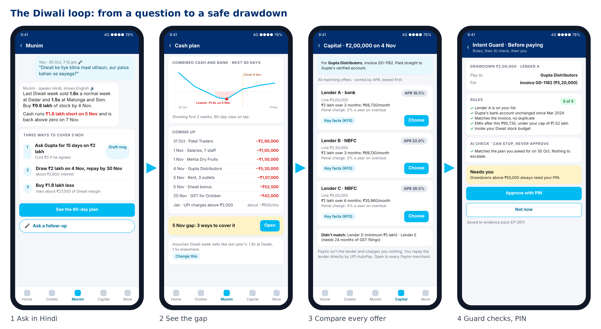
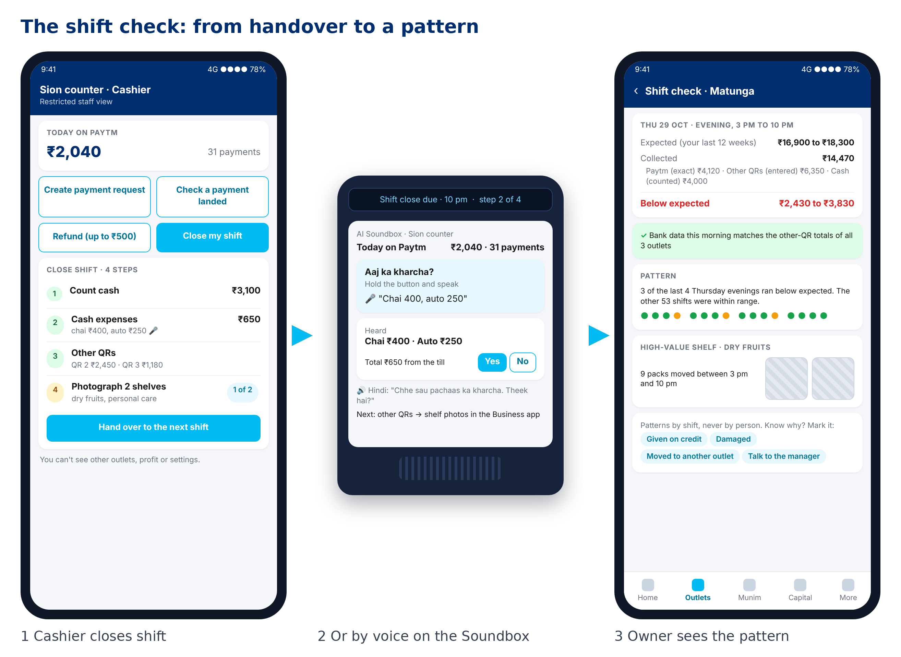

# AI Munim: wireframes for the presentation

Image versions of the screens used in the pitch (low-fidelity, 360 × 800 mobile, Paytm-style colours, transparent background so they sit on any slide). Every figure and name is illustrative and matches `AI_Munim_Pitch_Deck.md` and `AI_Munim_Project_Plan.md`. The brand logo is a placeholder box; drop official Paytm assets in at the design stage.

## Ready-made strips for slides

| File | Use on |
|---|---|
| `strip_diwali_loop.png` | Slide 5: from a Hindi question to a safe drawdown |
| `strip_shift_check.png` | Slide 5: cashier handover, Soundbox voice, owner's pattern view |





## The screens

| # | File | Screen | Slide | What it shows |
|---|---|---|---|---|
| 1 | `01_home.png` | Munim home | 7 | Collections per outlet, three alerts, Capital, October profit by outlet, voice |
| 2 | `02_consent.png` | Connect your data | Appendix | Account Aggregator consent in plain words; lenders ask separately |
| 3 | `03_mandate.png` | Your rules | 6 | Roles and limits, approved payees, credit cap, "always ask me" |
| 4 | `04_ask_diwali.png` | Ask in Hindi | 5, 7 | The Diwali question, answer, three ways to cover the gap |
| 5 | `05_cash_plan.png` | Cash plan | 5, 7 | Balance dipping below zero on 5 Nov, dated outflows, editable assumption |
| 6 | `06_capital_offers.png` | Capital | 5, 7 | Every matching offer, lowest APR first, KFS, lenders that didn't match |
| 7 | `07_intent_guard.png` | Intent Guard check | 6, 7 | Rules 5 of 5, AI check (can stop, never approve), PIN |
| 8 | `08_shift_check.png` | Shift check | 5, 7 | Expected vs collected, bank confirmation, pattern, shelf photos, reasons |
| 9 | `09_cashier_close_shift.png` | Cashier's view | 5 | Four-step shift close including cash expenses |
| 10 | `10_voice_expense.png` | Voice expense logging | Appendix | "Check what I heard": amounts, outlet chips, till or pocket |
| 11 | `11_cost_rules.png` | Cost rules | Appendix | Found in bank data, shared-cost split, effect on profit |
| 12 | `12_profit_by_outlet.png` | Profit by outlet | Appendix | Per-outlet P&L, why Sion loses money, confidence labels |
| 13 | `13_plan_receipt.png` | Your plan | 10, 11 | Membership, passes, next charge, monthly receipt |
| 14 | `14_soundbox_shift_close.png` | AI Soundbox | 5 | Shift close by voice on the device |

## Not wireframed as images yet

These exist as text layouts in `AI_Munim_Project_Plan.md` (Part 6) or are still open:
- Join and plan preview (W0), Outlets (W12), Capital home (W13), Evidence log (W10), CA pack (W15), degraded states (W16): text layouts.
- Voice-log approval for a cashier over the limit (W17c) and cost-rule change review (W18d): text layouts.
- "Change this" assumption editing on the cash plan: not designed yet.
- Supplier message draft (option 1 of the cash gap), staff management and notification settings: not designed yet.

## Regenerate or edit

The screens are plain HTML rendered to PNG.

```
cd wireframes/source
python3 gen.py        # writes html/ (edit the text and numbers in gen.py)
node shot.js          # needs Playwright; writes png/
```

Design tokens used: Paytm Blue `#00BAF2` (actions, chips), navy `#002E6E` (app bar, headings), `#F4F6F9` ground, white cards with 12 px radius, success green `#16A34A`, warning amber `#F59E0B`, error red `#DC2626`. Confirm against the official assets.
